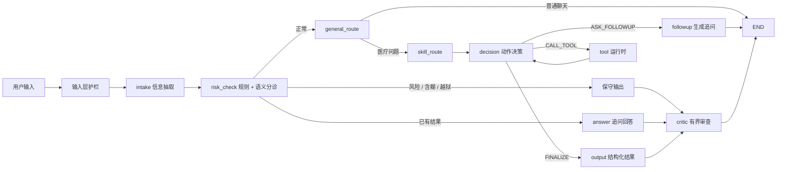

# 智能问诊与症状分析 Agent（Consult/Lab）

一个从 0 到 1 独立完成的智能问诊 Agent 全栈项目，也是 Agent 工程实践的求职作品。

它以**虚构模拟病例**为输入，重点不在"让模型聊天"，而在把 Agent 做成一套可编排、可约束、可观测、可评测的系统：LangGraph 单图状态机负责流程，模型只负责在受限动作空间里"提议"，程序负责校验、闸门和兜底；外层再叠加分层安全、RAG、工具运行时、记忆与上下文治理、技能包、账号与隐私。

> **使用边界：** 本项目只用于软件演示和开发学习，不面向真实患者，不提供医疗诊断、治疗、用药或分诊建议。请勿输入真实个人或健康信息。内置规则、知识条目和评测集都只用于验证软件行为，不构成临床依据。

---

## 当前状态（2026-11-16）

| 项目 | 现状 |
| --- | --- |
| 开发阶段 | Phase 0–F 完成；Phase F 的临床审核与药师审核仍待人工 |
| 后端规模 | 88 个 Python 模块，约 13,000 行 |
| 后端测试 | **703 passed** |
| Agent 图 | 10 个节点，3 个动作（追问 / 调工具 / 收束） |
| API | 23 个端点（会话、流式、记忆、反馈、账号、历史、导出、删除） |
| 工具 | 3 个内部知识工具 + 10 个外部 MCP 工具 |
| 技能包 | 3 个：`default`、`headache`、`pediatric_fever` |
| 知识库 | 112 条知识条目 + 19 条 OTC 说明书 |
| 固定评测集 | 33 条案例（dev 26 / holdout 7） |
| 检索指标 | recall@5 **1.000**、faithfulness **0.983** |
| 安全评测 | 红旗严格召回 **1.00**、误报 **0.00**；语义红队拦截 **48/48**、正常样本误杀 **0/12** |
| 前端 | React 18 + Vite，约 6,100 行（含 3,500 行手写 CSS） |

这些数字衡量的是固定虚构案例上的软件流程、安全拦截、检索与路由正确性，**不是临床诊断准确率**。评测口径与逐次变更见 [指标变更日志](docs/metrics-log.md)。

---

## 项目能做什么

- 接收一段虚构症状描述，按当前技能抽取字段，区分已知信息与仍缺失的信息。
- 在普通决策前运行独立风险规则与语义风险分诊；命中风险、含糊或越狱时走固定的保守分支。
- 根据会话状态选择动作：追问、调用受限工具或收束；每次请求最多追问一次，普通追问最多三次。
- 按症状或人群选择技能包（头痛、儿童发热、默认），技能决定字段、追问顺序、工具白名单和输出模板。
- 通过工具运行时调用内部知识工具或外部 MCP 工具，工具名、参数、风险等级和调用次数都受程序约束。
- 从 pgvector 知识库检索带出处的科室方向、红旗和就医指引；查不到时明确说"暂无依据"，不拿相近条目凑数。
- 用会话记忆卡和滚动摘要跨轮保留信息；刷新页面后从 SQLite 检查点恢复会话。
- 提供账号注册、登录、邮箱验证、找回密码、会话历史、置顶与重命名。
- 支持 SSE 流式处理：前端能显示"提取信息 → 安全检查 → 规划 → 检索 → 整理"的节点进度。
- 提供知情同意、数据导出、账号删除和 90 天保留期清理。
- 通过 33 条固定案例、探针、对抗集、judge、压测和 CI 门禁检查软件行为。

---

## 技术栈

| 部分 | 技术 |
| --- | --- |
| 后端 API | Python 3.11、FastAPI、Uvicorn、Pydantic 2 |
| Agent 工作流 | LangGraph 单图状态机、SQLite Checkpointer |
| 模型接入 | OpenAI 兼容客户端（DashScope / qwen）、instructor 结构化输出、失败降级 |
| 知识检索 | PostgreSQL 16 + pgvector、向量 + 关键词双路检索、加权融合 |
| 工具协议 | MCP（stdio / streamable HTTP）、ToolSpec 契约、重试与熔断 |
| 安全 | 分层护栏、guardrails-ai 校验器、语义风险分诊、有界 critic、审计 JSONL |
| 可观测性 | Trace / Span / Session 三层模型、JSONL sink、Langfuse、OTel 属性映射 |
| 前端 | React 18、Vite、手写 CSS |
| 部署 | Docker、Docker Compose、Nginx |
| 测试与 CI | pytest、GitHub Actions、mock 模式评测门禁 |

---

## 快速开始

### 方式一：Docker Compose（推荐）

需要 Docker Desktop 或 Docker Engine，并安装 Docker Compose。项目根目录下运行：

```sh
cp -n .env.example .env
docker compose up --build -d
```

`cp -n` 会在 `.env` 尚不存在时创建模板副本，不会覆盖已有的 `.env`。

主应用栈包含三个服务：

| 服务 | 作用 |
| --- | --- |
| `frontend` | Nginx 托管 React 构建产物，并把 `/sessions`、`/auth`、`/me`、`/docs` 转发给后端 |
| `backend` | FastAPI + Agent 图，SQLite 会话数据存在命名卷 `consultations_data` |
| `knowledge-db` | PostgreSQL 16 + pgvector，向量数据存在命名卷 `knowledge_pg_data` |

启动后可访问：

| 服务 | 地址 |
| --- | --- |
| 前端演示界面 | <http://localhost:8081> |
| Swagger API 文档 | <http://localhost:8081/docs> |
| OpenAPI JSON | <http://localhost:8081/openapi.json> |
| 向量库（仅本机） | `127.0.0.1:15433` |

前端端口可用 `FRONTEND_PORT` 覆盖：

```dotenv
FRONTEND_PORT=3000
```

后端端口只在 Compose 内部网络开放；前端、API 和 Swagger 都通过 Nginx 的前端端口访问。

#### 两种知识库模式

**离线演示（默认，不需要模型 Key）**：`.env.example` 已设置

```dotenv
KNOWLEDGE_BACKEND=stub
```

知识工具会使用确定性的关键词替身，只保证流程能跑完；它不返回检索命中，也没有出处，**不能用于评估检索质量**。

**真实检索（需要模型 Key）**：在 `.env` 中改为

```dotenv
KNOWLEDGE_BACKEND=pgvector
DASHSCOPE_API_KEY=填入你自己的密钥
EMBEDDING_PROVIDER=dashscope
```

启动并建立索引：

```sh
docker compose up -d knowledge-db
docker compose up --build -d
docker compose exec backend python -m backend.app.knowledge
```

索引是幂等的：同一个条目重复执行只会覆盖，不会产生重复行。首次入库会对 112 条知识逐条向量化，需要有效的 embedding 配额。

> 如果暂时不想接真实模型，但想验证完整检索链路，也可以把 `EMBEDDING_PROVIDER` 设为 `mock`。mock 向量是文本哈希生成的确定性伪向量，只能跑通链路，recall 没有意义。

### 方式二：本机开发

需要 Python 3.11、[uv](https://docs.astral.sh/uv/) 和 Node.js（建议 20）。

安装依赖：

```sh
uv sync --locked
cd frontend && npm ci
```

启动向量库（真实检索时需要）：

```sh
docker compose up -d knowledge-db
```

建立知识索引（需要模型 Key；离线演示可跳过）：

```sh
uv run python -m backend.app.knowledge
```

分别在两个终端启动后端与前端。

终端一（项目根目录）：

```sh
uv run uvicorn backend.app.api.routes:app --reload --host 0.0.0.0 --port 8000
```

离线演示时：

```sh
KNOWLEDGE_BACKEND=stub uv run uvicorn backend.app.api.routes:app --reload --host 0.0.0.0 --port 8000
```

终端二：

```sh
cd frontend
npm run dev
```

打开 <http://localhost:5173>。Vite 会把 `/sessions`、`/auth`、`/me` 代理到 `http://localhost:8000`。可用 `API_TARGET` 修改代理目标：

```sh
API_TARGET=http://localhost:8000 npm run dev
```

后端默认把 SQLite 文件写在项目根目录的 `consultations.sqlite`（已被 Git 忽略）。可用 `CONSULTATION_DB_PATH` 指定其他位置：

```sh
CONSULTATION_DB_PATH=/tmp/consultation-demo.sqlite uv run uvicorn backend.app.api.routes:app --reload
```

### 模型决策模式

默认 `USE_MODEL=0`，使用本地确定性 mock 决策器，不发起外部模型请求。要使用 DashScope 模型，先在 `.env` 中配置 `DASHSCOPE_API_KEY`，再开启模型模式：

```sh
USE_MODEL=1 uv run uvicorn backend.app.api.routes:app --reload
```

后端会读取 `DASHSCOPE_API_KEY`、`DASHSCOPE_MODEL` 和 `DASHSCOPE_BASE_URL`；当前终端已设置的同名变量优先。模型只提出允许的动作，程序仍会校验动作、工具名、参数和预算。

Docker Compose 使用独立开关 `USE_MODEL_DOCKER=1`，不会影响本机 pytest 和 uvicorn 的 `USE_MODEL`。

### 常用开关

| 变量 | 默认 | 说明 |
| --- | --- | --- |
| `USE_MODEL` | `0` | 是否使用真实模型；0 时为确定性 mock |
| `KNOWLEDGE_BACKEND` | `pgvector` | `pgvector` 真实检索；`stub` 无向量库替身 |
| `EMBEDDING_PROVIDER` | `dashscope` | `mock` 只用于离线跑链路 |
| `SKILLS_ENABLED` | `1` | 0 时图内回到 default 技能 |
| `SKILL_ROUTER_MODE` | `hybrid` | `rule` / `model` / `hybrid` |
| `MCP_ENABLED` | `0` | 外部 MCP 工具默认关闭 |
| `SEMANTIC_RISK_ENABLED` | `0` | 语义风险分诊默认关闭 |
| `CRITIC_ENABLED` | `0` | 有界输出审查默认关闭 |
| `SUMMARY_ENABLED` | `1` | 长会话滚动摘要，仅模型模式触发 |
| `AUTH_MODE` | `off` | `required` 时机器客户端必须带 `X-API-Key` |
| `RATE_LIMIT_ENABLED` | `1`（Compose） | 令牌桶限流总开关 |
| `PRIVACY_CONSENT_REQUIRED` | `0` | 1 时注册后必须先同意隐私说明 |
| `DATA_RETENTION_DAYS` | `90` | 会话保留天数 |

完整列表和注释见 [.env.example](.env.example)。

### Docker Compose 常用命令

以下命令都在项目根目录运行：

| 命令 | 用途 |
| --- | --- |
| `docker compose up -d` | 后台启动服务 |
| `docker compose up -d --build` | 重新构建镜像并后台启动 |
| `docker compose ps` | 查看服务状态 |
| `docker compose logs -f backend` | 跟踪后端日志 |
| `docker compose exec backend sh` | 进入后端容器 |
| `docker compose down` | 停止并移除容器，保留数据卷 |
| `docker compose down -v` | 同时删除 SQLite 与向量库数据，请谨慎使用 |
| `docker compose config` | 检查并展开 Compose 配置 |

### 第二套 Compose：本地 Langfuse 观测栈（可选）

项目里有两套互相独立的 Compose，容器、网络和数据卷互不影响：

| 栈 | Compose 文件 | Compose 项目名 | 包含服务 | 访问端口 |
| --- | --- | --- | --- | --- |
| 主应用 | `docker-compose.yml` | `agent`（默认取目录名） | backend、frontend、knowledge-db | 8081 |
| 观测栈 | `docker-compose.observability.yml` | `consultation-observability` | langfuse-web、langfuse-worker、Postgres、ClickHouse、Redis、MinIO | 3000 等 |

建议所有命令都带 `-f` 指定文件，避免误操作另一套：

```sh
docker compose -f docker-compose.yml ps
docker compose -f docker-compose.observability.yml up -d
```

观测栈启动后可访问：

| 服务 | 地址 |
| --- | --- |
| Langfuse 界面 | <http://localhost:3000> |
| 本地账号 | `local@example.com` / `localpassword` |
| Langfuse OTLP 地址 | `http://127.0.0.1:3000` |

首次启动会自动创建组织、项目和本地密钥（`pk-lf-local` / `sk-lf-local`）。在 `.env` 中启用观测：

```dotenv
TRACE_SINK=jsonl,langfuse
LANGFUSE_PUBLIC_KEY=pk-lf-local
LANGFUSE_SECRET_KEY=sk-lf-local
LANGFUSE_HOST=http://127.0.0.1:3000
```

注意 `LANGFUSE_HOST` 用 `127.0.0.1`，不要用 `localhost`：本机 `localhost` 可能解析到 IPv6，Docker 端口映射在 `::1` 上会返回 502。容器内访问宿主机则用 `host.docker.internal`，对应变量是 `LANGFUSE_HOST_DOCKER`。

`down -v` 会删除数据卷：主应用会清除 SQLite 会话与向量库；观测栈会清除 Langfuse 的账号、项目和全部轨迹。只想临时释放资源时用 `down`。观测栈约占 3.5 GB 内存，不排查时建议停掉。

---

## 系统架构

### 分层结构

```
编排层    LangGraph 单图 + 技能路由 + 可选 critic
             ↓
能力层    ContextAssembler / Memory / ToolCatalog / SkillRegistry
             ↓
模型层    OpenAI 兼容客户端 / instructor / embedding
             ↓
基础设施  SQLite checkpoint / PostgreSQL + pgvector / Langfuse / 审计 JSONL
```

能力层只做装配与调度，不承载业务规则，也不接管安全门控。核心原则是：**能力可以失败，但不能绕过闸门**。

### Agent 工作流



图状态包含已收集字段、字段证据、缺失字段、当前技能、已问问题、追问次数、风险标记、工具结果、会话记忆、对话和 trace。

- 风险检查固定在 decision 之前；外部工具结果不能改变风险等级。
- `decision` 每次只选一个动作；`tool` 执行后回到 `decision`，单轮最多调用 3 次工具。
- `followup` 一次请求只追问一次，等待用户下一轮回答。
- `output` / `answer` 之后统一经过 `critic`；critic 默认关闭，开启时只有 pass / block 两种结论。

### 状态与持久化

API 用 `session_id` 作为 LangGraph 的 `thread_id`，由 SQLite Checkpointer 保存状态和对话检查点。相同会话跨请求恢复，不同 `session_id` 相互隔离。删除会话会删除对应 checkpoint 和账号历史行。

处理中间状态可能是 `followup`；最终结果的 `status` 为 `completed`、`risk_route`、`refused` 或 `error`。正常结果会区分已知事实与未知信息，并附带下一步说明和用途限制；系统不生成确定诊断、处方或剂量。

---

## 核心能力

### 1. 状态驱动决策：模型提议，程序裁决

- 模型只能在 `ASK_FOLLOWUP` / `CALL_TOOL` / `FINALIZE` 三个动作中选择，并可给出工具名与参数。
- 程序负责置信度闸门、动作合法性、工具白名单、参数 Schema、单轮调用预算和状态不变量。
- 关键不变量：没有成功调用过工具，不允许 FINALIZE；模型想重复调用同一工具会被拦下。
- 模型不可用、返回非法 JSON 或置信度低于 0.6 时，自动回退到确定性规则决策。
- trace 同时记录模型选择和最终执行动作，能回答"模型原本想做什么、为什么被改"。

### 2. 分层安全

安全不是一道关键词检查，而是三道可以独立失效的防线：

| 层 | 做什么 | 位置 |
| --- | --- | --- |
| 输入层 | 归一化（去零宽字符）、越狱/提示注入识别、PII 脱敏、红旗/含糊规则 | `backend/app/safety/input_rail.py` |
| 决策层 | 风险优先于模型动作、连续含糊收束、审计事件、语义风险分诊 | `backend/app/safety/policy.py`、`backend/app/agent/semantic_risk.py` |
| 输出层 | guardrails-ai 校验诊断、药物建议、免责声明、知识来源；critic 做二次审查 | `backend/app/safety/validators.py`、`backend/app/safety/output_rail.py`、`backend/app/agent/critic.py` |

- 红旗和越狱输入不进入普通决策；输出校验失败时整段替换为固定安全文案。
- 语义风险分诊放在 decision 之前：隐性红旗不会因为关键词没命中而被当成普通症状继续追问。
- critic 只有否决权，不生成最终文案；超时或失败视为 pass，不作为单点故障。
- 每次风险升级写一行 `logs/audit.jsonl`（时间、规则、动作、输入短哈希），trace 里对应 `safety.input` / `safety.policy` / `safety.output` / `safety.escalation` 四类 span。

50 条分层对抗集覆盖明示红旗、隐性红旗、否定、越狱、诱导处方和情绪化表达：

```sh
uv run python -m eval.adversarial_eval
```

60 条语义红队样本覆盖隐性红旗、间接用药、引用编造、焦虑施压、权威施压、提示注入和多轮渐进：

```sh
USE_MODEL=1 uv run python -m eval.semantic_redteam
```

### 3. 记忆与上下文治理

- **会话记忆卡**：已确认事实、已给结论、未决问题、最近话题、非字段细节，随 checkpoint 持久化。
- **滚动摘要**：最近窗口外累计 12 条触发，摘要 ≤300 字；失败时保留旧摘要并重试。
- **上下文装配**：按节点声明和字符预算组装消息，超预算按"安全相关 > 当前轮 > 历史摘要 > 早期原文"裁剪。
- **只读导出视图**：`GET /sessions/{id}/memory` 返回结构化记忆卡和 Markdown 视图，不改变会话状态。

长会话评测 `LS01`（24 轮 dev）和 `LS02`（20 轮 holdout）用于验证跨轮保持；远距上下文的 `answer` 探针从 0 提升到 1.000，说明信息来自记忆卡而不是更大的窗口。

### 4. 工具运行时与 MCP

工具契约在 `backend/app/tools/contract.py`，一个工具必须说清：叫什么、干什么、参数 Schema、超时、失败类型、空结果语义、风险等级和作用域。

| 风险等级 | 例子 | 策略 |
| --- | --- | --- |
| read-only / internal | 科室方向、红旗检索、就医指引 | 允许模型自动选择 |
| read-only / external | PubMed、openFDA、ClinicalTrials、MedlinePlus | 白名单 + 超时 + 结果摘要 |
| write / external | 预约、发消息、写档案 | 不进入自动决策 |
| sensitive | 身份、支付、定位 | 默认不接入 |

- 只有只读工具进入模型可见的工具目录；未注册、越权或非只读工具会被替换或拒绝。
- 工具结果进入上下文前压缩到 400 字；原始结果完整留在 state 里，供渲染、出处和审计使用。
- 只对 `timeout` / `unavailable` 重试，参数错误不重试，非幂等工具不重试；按工具独立熔断，冷却期内直接返回结构化失败。
- 外部工具超时或不可用时，主流程降级为"暂无依据"，不会把整轮问诊打成错误。

MCP 客户端支持 stdio 和 streamable HTTP。外部公开工具示例（默认关闭，需在 `.env` 显式配置 `MCP_SERVERS`）：

| MCP server | 工具 |
| --- | --- |
| openFDA | 药品说明书、召回、短缺、批准、不良事件 |
| ClinicalTrials | 试验检索、试验详情 |
| PubMed | 文献检索、文献详情 |
| MedlinePlus | 健康主题检索 |

### 5. 技能层

技能是程序性知识：这类病人该怎么问、按什么顺序问、什么时候停；RAG 是声明性知识：这个症状对应什么科室、有哪些红旗。

```
skills/<name>/
  SKILL.md          # 何时使用、问诊策略、禁忌
  manifest.yaml     # 字段 schema、追问优先级、工具白名单、输出模板
  examples.jsonl    # 少样本（可选）
  eval.jsonl        # 技能评测集
```

当前技能：

| 技能 | 用途 |
| --- | --- |
| `default` | 通用问诊，等价于原行为 |
| `headache` | 头痛、头晕、偏头痛等头部不适 |
| `pediatric_fever` | 儿童发热，额外收集年龄与体温 |

路由支持三种模式：`rule`（关键词规则）、`model`（模型选择）、`hybrid`（规则明确命中直接用，否则问模型）。模型只看到技能摘要，选中后才加载完整 `SKILL.md`，避免技能变多后 prompt 膨胀。技能加载失败时回退 default，不阻断问诊。

### 6. 知识库与检索

- 知识条目 112 条：科室方向 79、红旗 20、就医准备 13，映射到 5 个公开来源。
- 19 条 OTC 说明书增加 NMPA 来源，审核状态为 `pharmacist_pending`，仍保持 `verified=false`。
- 向量路负责语义相近，关键词路负责术语精确命中；两路各自取候选后按 `similarity + λ × keyword_score` 融合。
- 相似度低于阈值直接丢弃；关键词命中但向量分低的条目会被保留，避开了"双路都按阈值过滤"导致关键词路失效的问题。
- 检索结果带 `source_id`、`verified`、`review_status` 和 URL；查不到时明确返回 `no_match`，不拿相近条目凑数。

建索引：

```sh
uv run python -m backend.app.knowledge
```

检索评测：

```sh
uv run python -m eval.recall_eval
uv run python -m eval.faithfulness_eval
```

### 7. 可观测性

观测模型分三层：

- **Session**：一个会话，跨多轮对话。
- **Trace**：一次请求，图从 START 跑到 END。
- **Span**：一个节点或一次模型调用，可以嵌套。

trace 默认落 JSONL，也可同时送 Langfuse；采集端对手机号、身份证、邮箱、显式姓名做脱敏，敏感键整段替换为 `[REDACTED]`。观测是旁路：sink 写失败、观测服务不可达，都不会让问诊返回 500；没有 trace 时 `span()` 退化为 no-op，单测不需要额外配置。

### 8. 账号、隐私与产品化

- 注册、登录、登出、邮箱验证、重发验证邮件、忘记密码、重置密码。
- 密码使用加盐哈希；登录令牌只存在 HttpOnly Cookie 中；重置密码后吊销全部登录态。
- 游客会话可在登录后认领到账号；会话历史支持置顶、重命名、删除。
- 知情同意记录版本与时间；`PRIVACY_CONSENT_REQUIRED=1` 时未同意不能开始问诊。
- 数据导出返回账号、完整对话、结构化字段、工具结果、trace 摘要和反馈。
- 删除账号前再次验证密码，删除账号、checkpoint、历史行和反馈。
- `DATA_RETENTION_DAYS`（默认 90 天）控制保留期，清理脚本默认 dry-run。
- 服务边界：请求体 32KB、单条消息 2000 字、每调用方并发流 5 条、三维令牌桶限流、同一会话在途锁。

---

## API

### 账号接口

| 方法 | 路径 | 用途 |
| --- | --- | --- |
| `POST` | `/auth/register` | 注册并自动登录 |
| `POST` | `/auth/login` | 登录 |
| `POST` | `/auth/logout` | 登出并吊销令牌 |
| `GET` | `/auth/me` | 当前用户 |
| `POST` | `/auth/consent` | 记录知情同意 |
| `GET` | `/auth/privacy` | 隐私说明 |
| `POST` | `/auth/verify-email` | 邮箱验证 |
| `POST` | `/auth/resend-verification` | 重发验证邮件 |
| `POST` | `/auth/forgot-password` | 请求重置验证码 |
| `POST` | `/auth/reset-password` | 重置密码 |
| `GET` | `/auth/export` | 导出账号数据 |
| `POST` | `/auth/delete` | 删除账号 |

### 会话接口

| 方法 | 路径 | 用途 |
| --- | --- | --- |
| `POST` | `/sessions` | 创建会话；可传 `initial_message` |
| `POST` | `/sessions/{session_id}/messages` | 向会话发送一轮消息 |
| `POST` | `/sessions/{session_id}/stream` | SSE 流式处理一轮消息 |
| `GET` | `/sessions/{session_id}` | 读取当前持久化状态 |
| `GET` | `/sessions/{session_id}/memory` | 读取会话记忆卡（只读） |
| `DELETE` | `/sessions/{session_id}` | 删除会话及其检查点 |
| `POST` | `/sessions/{session_id}/feedback` | 提交本轮反馈 |
| `GET` | `/me/sessions` | 当前账号的会话历史 |
| `POST` | `/me/sessions/claim` | 认领游客会话 |
| `PATCH` | `/me/sessions/{session_id}` | 重命名或置顶 |
| `DELETE` | `/me/sessions/{session_id}` | 删除自己的会话 |

### 使用示例

创建会话并发送第一轮：

```sh
curl -s http://localhost:8081/sessions \
  -H 'Content-Type: application/json' \
  -d '{"initial_message":"虚构人物头部不适"}'
```

在同一会话中补充信息：

```sh
curl -s http://localhost:8081/sessions/SESSION_ID/messages \
  -H 'Content-Type: application/json' \
  -d '{"message":"虚构人物表示，前两天开始，主要在前额"}'
```

查询会话、记忆或删除：

```sh
curl -s http://localhost:8081/sessions/SESSION_ID
curl -s http://localhost:8081/sessions/SESSION_ID/memory
curl -X DELETE http://localhost:8081/sessions/SESSION_ID
```

响应包含 `session_id`、`trace_id`、`collected_facts`、`missing_fields`、`asked_questions`、`followup_count`、`suggested_replies`、`risk_flags`、`final_result`、`rendered_text` 和 `conversation`。

向已结束的会话继续发消息会走 `answer` 节点回答追问，不再重新开始问诊；不存在的会话返回 `404`；空白后续消息返回 `400`；请求体或消息超限分别返回 `413` / `422`。

---

## 自动化检查与评测

### 单元和 API 测试

开发依赖已在 `uv sync --locked` 中安装：

```sh
uv run pytest backend/tests/
```

当前结果：**703 passed**。

### 评测矩阵

评测脚本分三类：流程类默认使用确定性 mock；检索/忠实度类需要先建好 pgvector 索引；真实模型类会发起外部调用并产生费用，命令中已标注。

| 脚本 | 衡量什么 | 命令 |
| --- | --- | --- |
| `eval.run_eval` | 33 条固定案例的轨迹、风险路由、追问上限、工具与恢复 | `uv run python -m eval.run_eval --split dev` |
| `eval.risk_probe` | 红旗规则严格召回与误报 | `uv run python -m eval.risk_probe` |
| `eval.adversarial_eval` | 50 条分层对抗集 | `uv run python -m eval.adversarial_eval` |
| `eval.semantic_redteam` | 60 条语义红队，真实模型拦截率 / 误杀率 / 延迟 / 成本 | `USE_MODEL=1 uv run python -m eval.semantic_redteam` |
| `eval.critic_probe` | 有界 critic 的越界拦截与误杀 | `USE_MODEL=1 uv run python -m eval.critic_probe` |
| `eval.tool_selection` | M7 工具选择正确率与危险误调 | `uv run python -m eval.tool_selection` |
| `eval.context_retention` | M6 长会话上下文保持 | `uv run python -m eval.context_retention` |
| `eval.token_ledger` | M8 按节点的 token p50 / p95 | `uv run python -m eval.token_ledger` |
| `eval.skill_routing` | M9 技能路由准确率 | `uv run python -m eval.skill_routing --mode rule` |
| `eval.skill_eval` | 每技能评测集 | `uv run python -m eval.skill_eval` |
| `eval.recall_eval` | 检索 recall@k | `uv run python -m eval.recall_eval` |
| `eval.faithfulness_eval` | 回答对检索依据的忠实度 | `uv run python -m eval.faithfulness_eval` |
| `eval.source_check` | 知识来源结构与核验台账 | `uv run python -m eval.source_check --strict` |
| `eval.reliability_e2e` | 真实模型下的工具超时、重试、熔断与恢复 | `uv run python -m eval.reliability_e2e`（`--mock` 可离线调试） |
| `eval.load_test` | 并发压测 | `uv run python -m eval.load_test --concurrency 50` |

`recall_eval` 和 `faithfulness_eval` 依赖已建立的向量索引；`reliability_e2e` 默认启动真实模型，加 `--mock` 只调试链路；`critic_probe` 固定使用真实模型。其余脚本默认走 mock，不会产生模型费用。

`run_eval` 的 33 条案例分为 `dev` 26 条和 `holdout` 7 条：日常用 `--split dev`，发版前才跑 `--split holdout`，单条调试可用 `--case E001,E030`。每条案例在 `hard_assertions` 里声明轨迹节点、风险路由、追问上限、工具结果、错误退路、会话恢复等硬约束，runner 只负责执行并报告失败断言。

### 单轮模型基线（可选，会产生模型调用）

基线脚本把每个案例的多轮输入合并为一条消息，只调用一次配置的模型；它不运行 Agent 图、风险门控或工具。需先配置 `.env` 中的密钥：

```sh
USE_MODEL=1 uv run python -m eval.baseline --cases eval/cases.jsonl --output eval/results/baseline-results.jsonl
```

用 `--limit 3` 只运行前 3 条案例。基线结果默认写在 Git 忽略的 `eval/results/` 下。该基线只用于同案例输入方式对照，不是临床质量基准。

评测输出写在 Git 忽略的 `eval/results/` 下：

- `agent-eval-results.jsonl`：逐案例的输入、状态和检查结果。
- `agent-eval-report.md`：dev/holdout 分层汇总、类别汇总、用量与延迟。

### 当前关键指标

| 指标 | 结果 | 样本 / 口径 |
| --- | --- | --- |
| 抽取槽位 F1 | 关键词 0.49 → 模型 **0.93 量级** | 30 条标注样本 |
| 红旗严格召回 | **1.00** | 24 条红旗探针 |
| 红旗误报率 | **0.00** | 同上 |
| 工具选择正确率 | **1.000**，危险误调 0 | M7，10 条 |
| 技能路由准确率 | **1.000**（rule / hybrid / model） | M9，20 条 |
| 上下文保持 | 远距 `answer` 探针 **1.000** | M6 长会话 |
| 检索 recall@5 | **1.000** | 正式检索集 |
| 检索 faithfulness | **0.983** | judge 评测 |
| 语义红队拦截 | 40/48 → **48/48** | 60 条，真实模型 |
| 语义红队误杀 | **0/12** | 正常对照 |
| critic 探针 | 越界 **6/6** 拦截、误杀 **0/6** | 12 条合成回答 |
| 真实模型延迟 / 成本 | p50 6.90s / p95 19.60s；约 **¥0.188 / 60 条** | qwen，语义分诊 + critic 开启 |

### CI

GitHub Actions 的 `quality` job 在无模型 Key、无向量库的环境下运行：

- `pytest` 全量测试
- `eval.run_eval --split dev` 硬断言
- `eval.skill_routing --mode rule` 与 `eval.skill_eval` 门禁（0.9）
- `eval.source_check` 来源结构检查
- `eval.red_team --split dev`
- `eval.risk_probe`、`eval.adversarial_eval`
- `eval.self_check` 与 `eval.ci_break_check` 门禁自检

CI 中设置 `KNOWLEDGE_BACKEND=stub`、`SKILL_ROUTER_MODE=rule`、`MCP_ENABLED=0`，确保不依赖外部服务。真实检索质量、真实模型红队和工具可靠性回归在本地手动运行。

---

## 目录结构

```text
.
├── backend/
│   ├── app/
│   │   ├── agent/          # 状态、图、抽取、决策、追问、回答、结果、critic、语义风险
│   │   ├── api/            # FastAPI 路由、账号、鉴权、限流、体积边界、在途锁
│   │   ├── accounts/       # 用户、会话归属、密码与令牌
│   │   ├── context/        # 节点预算与上下文装配
│   │   ├── memory/         # 会话记忆卡、滚动摘要、导出视图
│   │   ├── knowledge/      # 知识条目、来源、pgvector 索引与双路检索
│   │   ├── skills/         # 技能注册表与路由
│   │   ├── tools/          # ToolSpec 契约、目录、注册表、MCP、重试与熔断
│   │   ├── safety/         # 输入/策略/输出护栏、规则引擎、审计
│   │   ├── observability/  # Trace / Span、脱敏、JSONL 与 Langfuse sink
│   │   ├── privacy/        # 数据保留期清理
│   │   ├── feedback/       # 反馈存储与评分旁路
│   │   ├── llm/            # 模型客户端、结构化 Schema、embedding
│   │   ├── storage/        # SQLite Checkpointer
│   │   └── config.py       # 统一加载 .env
│   └── tests/              # 703 项单元、API、集成与评测结构测试
├── frontend/               # React + Vite 演示界面（登录、历史、流式、记忆、隐私）
├── skills/                 # 技能包：default / headache / pediatric_fever
├── prompts/                # 版本化 system prompt：intake / decision / router / followup / answer / drug
├── eval/                   # 33 条案例、探针、红队、judge、压测与评测 runner
├── docs/
│   ├── assets/             # 能力成熟度图、目标运行时图、早期界面截图
│   ├── planning/           # 路线图、阶段计划、指标定义、交接说明
│   ├── spec.md             # 产品规格
│   ├── progress.md         # Day 1–20 开发记录
│   ├── metrics-log.md      # 每次改动的指标变化
│   ├── eval-report*.md     # 各阶段评测报告
│   └── demo-script.md      # 录屏与面试讲解脚本
├── learning/               # Day 1–3 的独立学习练习，不是应用入口
├── logs/                   # 本地 trace、审计与评分（Git 忽略）
├── .env.example
├── pyproject.toml
├── uv.lock
├── Dockerfile
├── docker-compose.yml
├── docker-compose.observability.yml
└── run.py                  # 本地图流程演示入口
```

---

## 文档索引

- [产品规格](docs/spec.md)：目标、输入输出、动作边界与验收标准。
- [开发进度](docs/progress.md)：Day 1–20 的实现记录。
- [指标变更日志](docs/metrics-log.md)：每次改动"改了什么 → 哪个数字变了"。
- [指标定义与基线](docs/planning/optimization-metrics.md)：M1–M9 与 M11 的口径、样本与测量命令；M10 见能力路线图。
- [Agent 能力路线图](docs/planning/agent-capability-roadmap.md)：Phase A–F、五个核心接口、ADR 与风险登记册。
- [评测计划](docs/eval-plan.md)：案例集设计与指标口径。
- [评测使用说明](eval/README.md)：案例字段、Agent runner 和基线命令。
- [Phase 3 评测报告](docs/eval-report-phase3.md)：硬断言、judge 校准、n=5 稳定性、红队与 CI。
- [Phase 5 评测报告](docs/eval-report-phase5.md)：分层安全与对抗集。
- [Phase 3 执行计划](docs/planning/phase3-plan.md)、[Phase 5 计划](docs/planning/phase5-plan.md)、[Phase 6 计划](docs/planning/phase6-plan.md)、[Phase 6 L3 计划](docs/planning/phase6-l3-plan.md)。
- [药品信息边界](docs/drug-info-policy.md)：OTC 说明书的使用范围与审核状态。
- [演示与面试脚本](docs/demo-script.md)：约 4 分钟录屏流程、30 秒／2 分钟项目介绍和常见问题。
- [20 天开发计划](docs/planning/20-day-plan.md)：项目学习和实现路线。
- [项目交接说明](docs/planning/project-handoff.md)：项目背景、学习路线与参考资料。
- [能力成熟度图](docs/assets/agent-maturity-map.svg)、[目标运行时结构](docs/assets/target-agent-runtime.svg)。

学习和技术路线主要参考 [AgentGuide](https://github.com/adongwanai/AgentGuide)；[SmartMedicalConsultation](https://github.com/Zz3212281607/SmartMedicalConsultation) 仅用于可选的架构对照。本项目独立实现，没有把对照仓库作为运行依赖；静态审查和来源说明见[项目交接说明](docs/planning/project-handoff.md)。

---

## 当前限制

- 风险和含糊识别仍依赖有限规则与关键词，语义风险分诊也只能覆盖有限表达；不构成真实风险评估。
- 语义风险分诊和 critic 默认关闭；真实流量下的误杀率和 p95 增量还需要持续观察。
- 112 条知识条目目前是 `source_mapped`，尚未完成临床审核；19 条 OTC 说明书仍是 `pharmacist_pending`，不能当作用药依据。
- 自动评测使用固定虚构案例和 mock 决策器；通过结果不衡量模型答案质量、医学准确性或真实场景安全性。
- `KNOWLEDGE_BACKEND=stub` 与 `EMBEDDING_PROVIDER=mock` 只用于跑通流程，不能用于评估检索质量。
- DashScope 模式的行为、延迟和成本取决于所配置的模型与服务；运行基线或红队会产生外部请求和费用。
- SQLite 适合单机演示；多实例部署或并发写导致 p95 明显恶化时，才需要迁移到 PostgreSQL。
- 外部 MCP 工具默认关闭，示例使用公开托管端点；生产环境建议自托管并逐项审核工具权限。
- 本项目适合作为本地演示、学习和面试作品，不应直接作为面向真实患者的服务部署。
