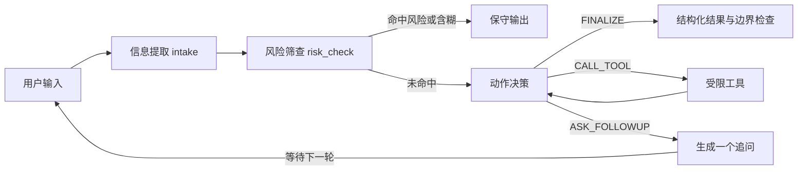

# 智能问诊与症状分析 Agent

一个用于展示 Agent 工程实践的求职演示项目。它以**虚构模拟病例**为输入，演示多轮状态管理、受限动作选择、风险规则分流、工具调用、SQLite 会话恢复和自动化轨迹评测。

> **使用边界：**本项目只用于软件演示和开发学习，不面向真实患者，不提供医疗诊断、治疗、用药或分诊建议。请勿输入真实个人或健康信息。内置风险规则是有限的演示规则，不保证识别所有风险情况。

项目已完成 Day 20 的作品集交付整理。后端 API、Agent 状态图和 React 演示界面均可运行；评测集包含 33 条虚构案例。最终验收中后端 72 项测试通过，确定性 mock 评测 33/33 通过。该结果只代表固定案例上的软件流程断言通过，不代表临床正确性，也不代表真实模型输出质量。评测口径见[评测报告](docs/eval-report.md)，录屏与讲解流程见[演示脚本](docs/demo-script.md)。

## 项目能做什么

- 接收一段虚构症状描述，提取已知信息并标记尚缺字段。
- 根据会话状态决定追问、调用受限工具或结束；每次请求最多提出一个追问，普通追问最多三次。
- 在普通决策前运行独立风险规则；命中预设风险或含糊表达时走固定的保守输出分支。
- 通过工具注册表运行科室方向映射等有限工具，不让模型任意执行代码或调用任意工具。
- 将会话状态和对话检查点保存在 SQLite，刷新页面后可以恢复；不同 `session_id` 的会话相互隔离。
- 通过 33 条案例检查 API 行为、状态轨迹、工具故障退路和会话恢复。

## 技术栈

| 部分 | 技术 |
| --- | --- |
| 后端 API | Python 3.11、FastAPI、Uvicorn、Pydantic 2 |
| Agent 工作流 | LangGraph |
| 会话持久化 | SQLite、LangGraph SQLite Checkpointer |
| 前端 | React 18、Vite、JavaScript |
| 容器运行 | Docker、Docker Compose、Nginx |
| 可选模型 | DashScope 兼容的 Chat Completions API；默认使用 mock 决策器 |

## 快速开始：Docker Compose

需要 Docker Desktop 或 Docker Engine，并安装 Docker Compose。项目根目录下运行：

```sh
cp -n .env.example .env
docker compose up --build
```

`cp -n` 会在 `.env` 尚不存在时创建模板副本，不会覆盖已有的 `.env`。默认不需要模型密钥，程序使用 mock 决策器；如果需要接入 DashScope，编辑 `.env`：

> 这里启动的是主应用栈（前后端）。可选的本地 Langfuse 观测栈是另一套独立 Compose，见[第二套 Compose](#第二套-composelocal-langfuse-观测栈可选)。

```dotenv
USE_MODEL=1
DASHSCOPE_API_KEY=填入你自己的密钥
DASHSCOPE_MODEL=qwen-plus
DASHSCOPE_BASE_URL=https://dashscope.aliyuncs.com/compatible-mode/v1
```

启动后可访问：

| 服务 | 地址 |
| --- | --- |
| 前端演示界面 | <http://localhost:8081> |
| 后端 API（经 Nginx 转发） | <http://localhost:8081/sessions> |
| Swagger API 文档 | <http://localhost:8081/docs> |
| OpenAPI JSON | <http://localhost:8081/openapi.json> |

前端端口可用 `FRONTEND_PORT` 覆盖。例如：

```dotenv
FRONTEND_PORT=3000
```

后端端口只在 Compose 内部网络开放，不占用本机端口。前端、API 和 Swagger 文档都通过 Nginx 的前端端口访问。

Compose 会把 SQLite 数据存入 Docker 命名卷 `consultations_data`。普通停止或重建容器不会删除会话数据：

```sh
docker compose down       # 停止并移除容器，保留数据卷
docker compose up --build # 重新构建并启动
docker compose down -v    # 同时删除数据卷和会话数据
```

### Docker Compose 常用命令

以下命令都在项目根目录运行：

| 命令 | 用途 |
| --- | --- |
| `docker compose up` | 前台启动服务，并在终端持续显示容器日志。 |
| `docker compose up -d` | 后台启动服务，终端立即返回；适合日常运行。 |
| `docker compose up -d --build` | 重新构建镜像并在后台启动；修改代码或 Docker 配置后使用。 |
| `docker compose ps` | 查看服务和容器的运行状态。 |
| `docker compose logs` | 查看容器日志。 |
| `docker compose logs -f` | 持续跟踪所有服务日志；按 `Ctrl+C` 退出查看，容器继续运行。 |
| `docker compose logs -f backend` | 只跟踪后端日志。 |
| `docker compose logs --tail=100` | 查看最近 100 行日志。 |
| `docker compose restart` | 重启服务，不重新构建镜像。 |
| `docker compose stop` | 停止容器但保留容器和数据卷；之后可用 `docker compose start` 启动。 |
| `docker compose start` | 启动之前已停止的容器。 |
| `docker compose down` | 停止并移除容器和网络，保留 SQLite 数据卷。 |
| `docker compose down -v` | 同时删除数据卷，会清除保存的会话数据。 |
| `docker compose exec backend sh` | 进入正在运行的后端容器；输入 `exit` 退出。 |
| `docker compose config` | 检查并展开 Compose 配置。 |

前台运行 `docker compose up` 时，按 `d` 可脱离日志界面并让容器继续运行；按 `Ctrl+C` 会停止前台运行的服务。后台启动后，可随时用 `docker compose logs -f` 查看日志。

### 第二套 Compose：本地 Langfuse 观测栈（可选）

项目里有两套互相独立的 Compose，容器、网络和数据卷互不影响：

| 栈 | Compose 文件 | Compose 项目名 | 包含服务 | 访问端口 |
| --- | --- | --- | --- | --- |
| 主应用 | `docker-compose.yml` | `agent`（默认取目录名） | backend、frontend | 8081 |
| 观测栈 | `docker-compose.observability.yml` | `consultation-observability`（文件内固定） | langfuse-web、langfuse-worker、Postgres、ClickHouse、Redis、MinIO | 3000 等 |

以下命令都在项目根目录运行。Docker 面板里会分别显示为 `agent` 和 `consultation-observability` 两组。**建议所有命令都带 `-f` 指定文件**，这样在项目根目录下不会误操作另一套：

| 操作 | 主应用 | 观测栈 |
| --- | --- | --- |
| 启动 | `docker compose -f docker-compose.yml up -d --build` | `docker compose -f docker-compose.observability.yml up -d` |
| 查看状态 | `docker compose -f docker-compose.yml ps` | `docker compose -f docker-compose.observability.yml ps` |
| 跟踪日志 | `docker compose -f docker-compose.yml logs -f backend` | `docker compose -f docker-compose.observability.yml logs -f langfuse-web` |
| 停止（保留数据） | `docker compose -f docker-compose.yml down` | `docker compose -f docker-compose.observability.yml down` |
| 停止并删除数据 | `docker compose -f docker-compose.yml down -v` | `docker compose -f docker-compose.observability.yml down -v` |
| 查看所有项目 | `docker compose ls` | 同左 |

观测栈启动后可访问：

| 服务 | 地址 |
| --- | --- |
| Langfuse 界面 | <http://localhost:3000> |
| 本地账号 | `local@example.com` / `localpassword` |
| Langfuse OTLP 地址 | `http://127.0.0.1:3000` |

首次启动会自动创建组织、项目和本地密钥（`pk-lf-local` / `sk-lf-local`）。在 `.env` 中启用观测：

```dotenv
TRACE_SINK=jsonl,langfuse
LANGFUSE_PUBLIC_KEY=pk-lf-local
LANGFUSE_SECRET_KEY=sk-lf-local
LANGFUSE_HOST=http://127.0.0.1:3000
```

注意 `LANGFUSE_HOST` 用 `127.0.0.1`，不要用 `localhost`：本机 `localhost` 可能解析到 IPv6，Docker 端口映射在 `::1` 上会返回 502。

`down -v` 会删除数据卷，请谨慎使用：主应用会清除 SQLite 会话数据；观测栈会清除 Langfuse 的账号、项目和全部轨迹。只想临时释放资源时用 `down`。观测栈约占 3.5 GB 内存，不排查时建议停掉，数据仍保留在卷里。

## 本机开发运行

需要 Python 3.11、[uv](https://docs.astral.sh/uv/) 和 Node.js（建议 20）。在项目根目录安装依赖：

```sh
uv sync --locked
cd frontend && npm ci
```

分别在两个终端启动后端与前端。

终端一（项目根目录）：

```sh
uv run uvicorn backend.app.api.routes:app --reload --host 0.0.0.0 --port 8000
```

终端二：

```sh
cd frontend
npm run dev
```

打开 <http://localhost:5173>。Vite 会把 `/sessions` 请求代理到 `http://localhost:8000`。也可通过 `API_TARGET` 修改代理目标：

```sh
API_TARGET=http://localhost:8000 npm run dev
```

后端默认把 SQLite 文件写在项目根目录的 `consultations.sqlite`（已被 Git 忽略）。可以用 `CONSULTATION_DB_PATH` 指定其他位置：

```sh
CONSULTATION_DB_PATH=/tmp/consultation-demo.sqlite uv run uvicorn backend.app.api.routes:app --reload
```

### 模型决策模式

默认使用本地确定性 mock 决策器，不发起外部模型请求。要使用 DashScope 模型，先在项目根目录 `.env` 中配置 `DASHSCOPE_API_KEY`，再以环境变量开启模型模式：

```sh
USE_MODEL=1 uv run uvicorn backend.app.api.routes:app --reload
```

后端会从 `.env` 读取 `DASHSCOPE_API_KEY`、`DASHSCOPE_MODEL` 和 `DASHSCOPE_BASE_URL`；当前终端已设置的同名变量优先。模型只提出允许的动作，程序仍会验证动作并执行规则门控。模型请求失败或动作无法解析时会回退到 mock 决策器。

Docker Compose 同样默认 `USE_MODEL=0`。可在 `.env` 里设为 `USE_MODEL=1`，密钥只通过容器环境变量传给后端，不会复制进镜像。

## Agent 工作流



图状态包含已收集字段、缺失字段、已问问题、追问次数、风险标记、工具结果、对话和 trace。API 使用 `session_id` 作为 LangGraph 的 `thread_id`，由 SQLite Checkpointer 保存状态。

处理中间状态可能是 `followup`；最终结果的 `status` 为 `completed`、`risk_route`、`refused` 或 `error`。正常结果会区分已知事实与未知信息，并附带下一步说明和用途限制；系统不生成确定诊断、处方或剂量。

### 分层安全（Phase 5）

安全不是一道关键词检查，而是三道可以独立失效的防线：

| 层 | 做什么 | 位置 |
| --- | --- | --- |
| 输入层 | 归一化、越狱/提示注入、PII 脱敏、红旗/含糊 | `backend/app/safety/input_rail.py` |
| 决策层 | 风险优先于模型动作、连续含糊收束、审计事件 | `backend/app/safety/policy.py`、`audit.py` |
| 输出层 | guardrails-ai 校验诊断、药物建议、免责声明、知识来源 | `backend/app/safety/validators.py`、`output_rail.py` |

红旗和越狱输入不进入普通决策；输出校验失败时整段替换为固定安全文案。每次风险升级写一行 `logs/audit.jsonl`（时间、规则、动作、输入短哈希），trace 里对应 `safety.input` / `safety.policy` / `safety.output` / `safety.escalation` 四类 span。

50 条分层对抗集覆盖明示红旗、隐性红旗、否定、越狱、诱导处方和情绪化表达：

```sh
uv run python -m eval.adversarial_eval
```


## API 使用示例

### 创建会话并发送第一轮

```sh
curl -s http://localhost:8081/sessions \
  -H 'Content-Type: application/json' \
  -d '{"initial_message":"虚构人物头部不适"}'
```

响应包含 `session_id`、`collected_facts`、`missing_fields`、`asked_questions`、`followup_count`、`risk_flags`、`final_result`、`rendered_text` 和 `conversation`。如果需要追问，`rendered_text` 中会显示当前问题。

### 在同一会话中补充信息

把创建接口返回的 ID 替换到 URL：

```sh
curl -s http://localhost:8081/sessions/SESSION_ID/messages \
  -H 'Content-Type: application/json' \
  -d '{"message":"虚构人物表示，前两天开始，主要在前额"}'
```

### 查询或删除会话

```sh
curl -s http://localhost:8081/sessions/SESSION_ID
curl -X DELETE http://localhost:8081/sessions/SESSION_ID
```

| 方法 | 路径 | 用途 |
| --- | --- | --- |
| `POST` | `/sessions` | 创建会话；可传 `initial_message` |
| `POST` | `/sessions/{session_id}/messages` | 向未结束的会话发送一轮消息 |
| `GET` | `/sessions/{session_id}` | 读取当前持久化状态 |
| `DELETE` | `/sessions/{session_id}` | 删除该会话的 SQLite 检查点 |

Swagger 文档提供交互式请求界面：<http://localhost:8081/docs>（本机开发时为 <http://localhost:8000/docs>）。向已结束的会话继续发消息会返回 `409`；不存在的会话返回 `404`；空白的后续消息返回 `400`。

## 自动化检查与评测

### 单元和 API 测试

开发依赖已在 `uv sync --locked` 中安装：

```sh
uv run pytest backend/tests/
```

### Agent 案例评测

```sh
uv run python -m eval.run_eval
```

该脚本使用确定性 mock 决策器，通过 FastAPI 测试客户端调用真实 API 和 graph，不需要模型密钥，也不会调用外部模型。33 个案例分为 `dev` 26 条和 `holdout` 7 条：日常用 `--split dev`，发版前才跑 `--split holdout`，单条调试可用 `--case E001,E030`。

每条案例在 `hard_assertions` 里声明要检查的硬约束（轨迹节点、风险路由、追问上限、工具结果、错误退路、会话恢复等），runner 只负责执行并报告失败断言。报告会同时给出 dev/holdout 分层汇总和逐条失败原因。

该脚本生成：

- `eval/results/agent-eval-results.jsonl`：逐案例的输入、状态和检查结果。
- `eval/results/agent-eval-report.md`：汇总报告。

输出目录被 Git 忽略。当前已记录的结果为三轮独立运行均 33/33 通过；Day 17 的失败/修复复盘见[评测报告](docs/eval-report.md)，Phase 3 的分层、judge、稳定性与红队结果见[Phase 3 评测报告](docs/eval-report-phase3.md)。

### 单轮模型基线（可选，会产生模型调用）

基线脚本把每个案例的多轮输入合并为一条消息，只调用一次配置的模型；它不运行 Agent 图、风险门控或工具。需先配置 `.env` 中的密钥：

```sh
USE_MODEL=1 uv run python -m eval.baseline --cases eval/cases.jsonl --output eval/results/baseline-results.jsonl
```

用 `--limit 3` 只运行前 3 条案例。基线结果会包含模型回复，默认写在 Git 忽略的 `eval/results/` 下。该基线仅供同案例输入方式对照，不是临床质量基准。

## 目录结构

```text
.
├── backend/
│   ├── app/
│   │   ├── agent/       # 状态、图、提取、追问、决策与结果生成
│   │   ├── api/         # FastAPI 路由与会话 API
│   │   ├── llm/         # 模型客户端与结构化 Schema
│   │   ├── observability/ # trace/span、脱敏与 Langfuse sink
│   │   ├── safety/      # 风险筛查与最终输出边界检查
│   │   ├── storage/     # SQLite Checkpointer
│   │   ├── tools/       # 受限工具注册表
│   │   └── config.py    # 统一加载 .env
│   └── tests/           # 后端单元与 API 测试
├── frontend/            # React + Vite 演示界面
├── eval/                # 33 条案例、基线脚本、Agent 评测器与轨迹报告
├── docs/
│   ├── assets/          # 演示截图与文档素材
│   ├── planning/        # 20 天开发计划与项目交接说明
│   ├── spec.md          # 产品规格
│   ├── progress.md      # 每日开发进度
│   ├── eval-plan.md     # 评测计划
│   ├── eval-report.md   # 评测结果报告
│   ├── demo-script.md   # 录屏讲解与面试介绍脚本
│   └── day3-retrospective.md # Day 3 复盘
├── learning/            # Day 1–3 的独立学习练习，不是应用入口
├── .env.example         # 本地环境变量模板
├── pyproject.toml       # Python 项目与依赖定义
├── uv.lock              # Python 依赖锁文件
├── Dockerfile           # 后端镜像
├── docker-compose.yml   # 前后端与 SQLite 数据卷编排
├── docker-compose.observability.yml # 可选 Langfuse 观测栈
└── run.py               # 本地图流程演示入口
```

## 文档索引

- [产品规格](docs/spec.md)：目标、输入输出、动作边界与验收标准。
- [开发进度](docs/progress.md)：Day 1–20 的实现记录和阶段结果。
- [评测计划](docs/eval-plan.md)：案例集设计与指标口径。
- [评测使用说明](eval/README.md)：案例字段、Agent runner 和单轮基线命令。
- [评测报告](docs/eval-report.md)：Day 17 失败基线与 Day 18 修复复测。
- [Phase 3 评测报告](docs/eval-report-phase3.md)：硬断言、judge 校准、n=5 稳定性、红队与 CI 的系统性结论。
- [指标定义与基线](docs/planning/optimization-metrics.md)：M1–M5 的口径、样本与测量命令。
- [Phase 3 执行计划](docs/planning/phase3-plan.md)：分层断言、judge、校准、采样、红队与 CI 的课程链路。
- [指标变更日志](docs/metrics-log.md)：每次改动对应的指标变化与结论。
- [演示与面试脚本](docs/demo-script.md)：约 4 分钟录屏流程、30 秒／2 分钟项目介绍及常见问题。
- [20 天开发计划](docs/planning/20-day-plan.md)：项目学习和实现路线。
- [项目交接说明](docs/planning/project-handoff.md)：项目背景、学习路线，以及参考资料和对照仓库的来源记录。
- [Day 15 前端预览图](docs/assets/day15-preview.png)：早期界面截图。

学习和技术路线主要参考 [AgentGuide](https://github.com/adongwanai/AgentGuide)；[SmartMedicalConsultation](https://github.com/Zz3212281607/SmartMedicalConsultation) 仅用于可选的架构对照。本项目独立实现，没有把对照仓库作为运行依赖；静态审查和来源说明见[项目交接说明](docs/planning/project-handoff.md)。

## 当前限制

- 风险和含糊识别依赖有限关键词规则，不能覆盖所有表达，也不构成真实风险评估。
- 拒答识别使用明确短语列表，未覆盖所有自然语言说法。
- 自动评测使用固定虚构案例和 mock 决策器；当前通过结果不衡量模型答案质量、医学准确性或真实场景安全性。
- DashScope 模式的行为、延迟和成本取决于所配置的模型与服务；运行基线会发起外部请求并产生相应费用。
- 本项目适合作为本地演示和学习样例，不应直接作为面向真实患者的服务部署。
