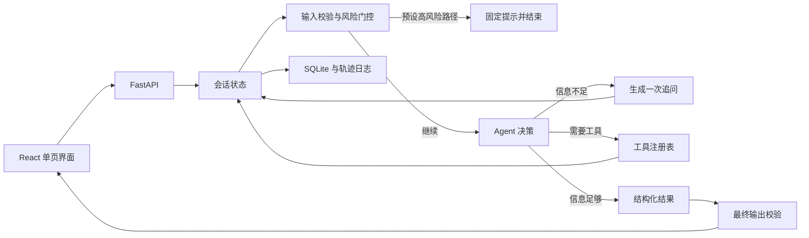

# 智能问诊与症状分析 Agent：20 天从零开发计划

> 版本：2026-10-08。适用对象：已有一个 RAG 项目、Agent 基础接近零、计划独立开发第二个求职作品的开发者。按每天约 3～4 小时设计；20 天是**开发周期**，不是掌握整个 Agent 领域或获得 offer 的保证。

## 0. 一页总览

**项目定位**：面向模拟病例的智能问诊与症状分析 Agent。输入一段症状描述后，系统维护问诊状态，按缺失信息决定是否追问，必要时调用独立工具，并输出结构化的症状摘要、可能方向和下一步建议。它是求职演示项目，不面向真实患者提供诊断或治疗。

**20 天完成的作品**：一个独立 Git 仓库、可本地运行的后端和单页前端、至少 30 条模拟评测案例、一份真实评测报告、一段 3～5 分钟演示、能在面试中解释的架构与取舍。

**核心区别**：已完成的 RAG 项目强调检索与知识问答；本项目强调“根据当前状态决定下一步动作”的 Agent Loop、动态追问、工具调用、会话恢复、风险边界和轨迹评测。可以使用少量人工整理的静态资料作为工具输入，但不以知识库建设、GraphRAG 或向量检索作为主线。

**学习来源的分工**：


| 来源                                                                                   | 本计划怎样使用                                                                                                                                                                                                                                                                                                                                                              |
| ------------------------------------------------------------------------------------ | -------------------------------------------------------------------------------------------------------------------------------------------------------------------------------------------------------------------------------------------------------------------------------------------------------------------------------------------------------------------- |
| [AgentGuide](https://github.com/adongwanai/AgentGuide)                               | 提供从 Agent 边界、最小 Loop、工具设计，到评测、可观测性和求职交付的学习顺序。重点参考[前 7 天入门](https://github.com/adongwanai/AgentGuide/blob/main/docs/00-getting-started/02-first-7-days.md)、[最小 Agent Loop](https://github.com/adongwanai/AgentGuide/blob/main/examples/minimal-agent-loop.md)、[项目交付指南](https://github.com/adongwanai/AgentGuide/blob/main/docs/03-practice/05-ship-agent-project.md)。 |
| [SmartMedicalConsultation](https://github.com/Zz3212281607/SmartMedicalConsultation) | 可选的后期对照材料；前四天无需克隆、安装或运行。自己的项目从空目录开始，不直接复制它的代码或宣传指标。 |


### 成功边界与非目标

1. **范围**：只支持中文文本问诊；只做一个会话入口和一个结果页。结果使用“症状分析／可能方向／建议行动”等谨慎表述，不输出确定诊断、处方、剂量、停药建议。
2. **数据**：开发与演示仅用虚构、脱敏的模拟病例。不要把真实健康信息、API Key、会话数据库提交到公开仓库。
3. **安全**：高风险分流是项目的工程边界演示，不等于经过临床验证。关键风险检查应处于模型之外，并在最终输出前再次检查；免责声明不能替代风险控制。
4. **延期项**：Neo4j、GraphRAG、模型微调、九 Agent 架构、语音、图片、自动购药、医院挂号、公开用户注册。20 天内不因这些功能延误主流程和评测。
5. **公开展示**：优先提供本地可复现演示与录屏。若以后公开部署，只展示模拟案例入口；真实用户使用需要另行解决医疗审核、隐私、身份与运维问题。


## 1. 最小产品规格


### 1.1 用户可见流程

1. 用户输入一句症状描述，例如虚构案例“最近几天头部不适，想知道要补充哪些信息”。
2. 系统提取已知字段，并用有限步数追问最关键的缺失信息；用户可回答“暂时不知道”。
3. 每一轮都执行风险检查；若进入预设高风险路径，停止普通问诊并显示预设的求助提示。
4. 信息足够或达到追问上限时，Agent 决定调用科室建议或就诊准备工具，生成结构化结果。
5. 页面展示**已知信息、尚不确定的信息、系统调用的工具、下一步建议**；开发模式可查看简化轨迹。


### 1.2 体现 Agent 的决策点

模型每轮只能在注册的动作中选择，例如 `ASK_FOLLOWUP`、`CALL_TOOL`、`FINALIZE`。风险分流由确定性门控优先处理。动作选择必须读取当前状态；工具结果写回状态；下一轮可基于新信息重新决策。设置最大追问轮数、最大总步数、超时和可读的失败退路。若始终只是“意图分类 → 固定分支 → 回答”，作品只能称为工作流，应继续补足动态决策。

### 1.3 建议架构




**建议技术栈**：详见 1.4 节。先实现命令行闭环，再接 API 和前端。

**最小状态字段**：`session_id`、`turn_id`、`latest_user_message`、`collected_facts`、`missing_fields`、`asked_questions`、`followup_count`、`risk_flags`、`tool_results`、`next_action`、`final_result`、`trace`。只保存完成任务所需的最少信息。模型输出和工具参数用 Pydantic 校验，不接受任意工具名。

**最小工具**：


| 工具                   | 职责                       | 失败退路                 |
| -------------------- | ------------------------ | -------------------- |
| `risk_screen`        | 对预设风险场景做保守分流；返回规则编号和命中原因 | 无法判定时显示不确定性并建议寻求专业帮助 |
| `department_suggest` | 从受限映射中给出可能咨询的科室方向        | 无匹配则返回“暂无法判断”，不编造    |
| `visit_preparation`  | 按已收集事实生成就诊时可描述的信息清单      | 返回通用准备清单             |


这里的“工具”要有参数 schema、返回 schema、错误码、超时、调用记录；模型负责决定何时调用，工具负责按约束执行。不要让模型自由拼接数据库查询或任意网络请求。

### 1.4 技术栈与选型说明

- 后端使用 Python 3.11、LangGraph、Pydantic 2、FastAPI 和 SQLite；前端使用 React + Vite + JavaScript。
- 模型先接一家 API 供应商，用薄适配层隔离调用。Day 2 可先用预设决策练习 Loop，Day 3 再接模型 API；不要为学习 Loop 等待 Key 或网络。
- 用 pytest 验证组件和边界，用自写 JSONL 脚本运行模拟案例并生成评测结果。
- Day 4 在本项目核实依赖兼容性并固定后端版本；前端创建后提交 `package-lock.json`。Neo4j、GraphRAG、向量库和微调均不在当前主线。

### 1.5 验收指标

指标只针对**自建模拟评测集**，不得写成临床准确率。至少记录：

- 端到端任务完成率：是否按预期追问、工具调用、结束或转入风险分支。
- 必要信息追问覆盖率与重复追问率。
- 工具选择正确率、无效工具调用次数、最大步数触发次数。
- 固定风险案例的漏分流和误分流数量；特别检查否定句、含糊表述及跨轮补充信息。
- 结构化结果校验通过率、平均时延、每案例模型调用次数和成本。
- 失败案例按“信息提取／动作选择／工具／状态／输出边界”分类并附轨迹。

最低交付门槛：不少于 30 条模拟案例全部可由脚本运行；固定风险案例无漏分流；无未经校验的工具调用；README 从干净环境可复现。结果分数必须以真实运行输出填写，不能预先承诺或引用参考仓库的数字。

## 2. 每日开发安排

> 每天按“学习 30～60 分钟 → 实现 2～2.5 小时 → 验证与笔记 30～60 分钟”推进。验收未通过时，第二天先修复，减少界面润色等次要任务。


### 阶段 A：建立 Agent 基础与最小闭环（Day 1～4）


#### Day 1｜弄懂 Agent 的最小闭环

- **学习**：读 AgentGuide 的[Agent 基础](https://github.com/adongwanai/AgentGuide/blob/main/docs/01-theory/01-what-is-agent.md)和[前 7 天入门的 Day 1](https://github.com/adongwanai/AgentGuide/blob/main/docs/00-getting-started/02-first-7-days.md)。区分 Chatbot、固定 Workflow 和基于状态选动作的 Agent；理解目标、状态、动作、观察、终止与轨迹。
- **操作**：在纸上或 `learning/agent-basics.md` 手动推演两条虚构病例：信息不足时选择 `ASK_FOLLOWUP`，信息足够时选择 `CALL_TOOL` 或 `FINALIZE`；逐步写出读取的状态、动作、观察结果和停止原因。不调用医疗模型，也不输出诊断。
- **验证**：能用自己的话解释“为什么这个作品需要动态决策”；指出每条推演何时停止，以及如果用户回答“不知道”会怎样处理。
- **产物**：`learning/agent-basics.md`：一页概念笔记、两条手工轨迹和一个最小流程图。


#### Day 2｜用预设决策手写 Loop

- **学习**：读 AgentGuide 的[最小 Loop 模板](https://github.com/adongwanai/AgentGuide/blob/main/examples/minimal-agent-loop.md)，理解“读取状态 → 选择动作 → 执行 → 写回观察 → 再决策”。先不引入 LangGraph 或模型 API。
- **操作**：准备 Python 3.11 和独立 `venv`；写一个小练习，用两种无医疗风险的本地工具和预设决策器模拟模型，最多运行 5 步。记录每步动作与观察，能主动结束。
- **验证**：正常任务可结束；未知工具、工具报错和达到步数上限都给出可读结果，不死循环。
- **产物**：`learning/minimal_loop.py` 的首版和至少三条运行轨迹。


#### Day 3｜让模型决定下一步

- **学习**：理解模型输出需要校验，以及模型决策与工具执行的分工；看 AgentGuide 的[工具设计日程](https://github.com/adongwanai/AgentGuide/blob/main/docs/00-getting-started/02-first-7-days.md)。
- **操作**：在 Day 2 的练习上接入单一模型 API 薄适配层；模型只能返回 `tool` 或 `final`，工具名须在白名单。加入参数校验、结构化错误、超时和 JSONL trace。只用无医疗风险任务。
- **验证**：五个固定任务能完成；模型返回未知工具或无效参数、工具超时、达到步数上限时都可读地结束。若 Key 或网络不可用，保留预设决策器完成 Loop 验收，并记录外部阻塞。
- **产物**：`learning/minimal_loop.py` 完整版、两种决策器和一页失败复盘；练习代码不作为产品入口。


#### Day 4｜新仓库、规格与评测草案

- **学习**：读 AgentGuide 的[项目交付指南](https://github.com/adongwanai/AgentGuide/blob/main/docs/03-practice/05-ship-agent-project.md)中“先写 Spec”和“评测、归因”。
- **操作**：在当前独立项目目录初始化 Git 仓库。写 `docs/spec.md`：目标用户、输入输出、三个演示场景、非目标、风险边界、最大轮数和停止条件；写 `docs/eval-plan.md`：先列出 10 条案例的期望行为，后续扩到 30 条。核实并固定兼容依赖版本，提交 `.gitignore` 和 `.env.example`。
- **验证**：不用提“九 Agent”或“GraphRAG”，也能讲清楚为什么当前项目需要动态追问与工具决策。
- **产物**：可审阅的需求规格、目录骨架、第一笔 commit。


### 阶段 B：从零实现后端 Agent（Day 5～12）


#### Day 5｜定义状态与图骨架

- **学习**：理解 LangGraph 的状态、节点、条件边、结束节点。把 Day 3 的 Loop 映射到状态图。
- **实现**：定义 `ConsultationState`、动作枚举及 Pydantic 模型；建入口、风险检查、决策、追问、工具、输出节点。先用假数据或 mock 模型跑通。
- **验证**：一条普通输入走到输出，一条预设风险输入走到固定提示；状态字段在每个节点前后可打印。
- **产物**：`backend/app/agent/state.py`、`graph.py` 和最小流程测试。


#### Day 6｜结构化信息提取

- **学习**：理解结构化输出、字段缺失、校验失败与“不知道”值的区别。
- **实现**：只提取必要字段，例如主要症状、持续时间、伴随表现、已知背景。提取失败时保留原文、记录错误，不猜测缺失字段。
- **验证**：至少 8 个模拟输入覆盖完整、缺失、模糊、否定描述；输出满足 schema。
- **产物**：`intake.py`、字段 schema、8 条组件测试。


#### Day 7｜设计并生成动态追问

- **学习**：理解“追问什么”是策略决策，而非固定问卷。优先追问会改变下一步处理的信息。
- **实现**：根据 `missing_fields`、已问过的问题和回答历史，生成一个简短问题；对重复问题去重。
- **验证**：同一句首问在不同补充信息下产生不同下一问；“不知道”不会导致重复循环。
- **产物**：`followup.py`、三条可复现的多轮轨迹。


#### Day 8｜追问停止条件与恢复

- **学习**：理解最大轮数、用户中止、信息仍不足、状态恢复。
- **实现**：设置最大追问次数（先用 3 次作为工程上限，可由评测调整）和总步数上限。达到上限时输出“已知／未知”，不编造答案。CLI 支持同一会话继续。
- **验证**：正常结束、用户说“不知道”、连续空输入、达到步数上限四种情况都不死循环。
- **产物**：`decision.py`、循环边界测试、状态转移图。


#### Day 9｜工具设计与注册

- **学习**：读 AgentGuide[工具设计日程](https://github.com/adongwanai/AgentGuide/blob/main/docs/00-getting-started/02-first-7-days.md)；区分工具职责、参数 schema、返回 schema 和错误码。
- **实现**：实现 `department_suggest` 与 `visit_preparation` 两个受限工具；统一注册、超时和错误结构。数据用小规模、人工可检查的演示映射。
- **验证**：正常、无匹配、非法参数、工具异常四类调用都有稳定结果。
- **产物**：`tools/`、工具说明表、工具测试。


#### Day 10｜让 Agent 自主选择动作

- **学习**：理解模型决策与规则约束的分工；模型可以选择已批准动作，但不能绕过风险检查。
- **实现**：决策器在 `ASK_FOLLOWUP`、`CALL_TOOL`、`FINALIZE` 中选择，输出必须结构化；工具返回写回状态，避免重复调用同一工具。
- **验证**：至少 5 条轨迹能展示“追问 → 回答 → 调工具 → 完成”，并能说明每步依据了哪些状态字段。
- **产物**：首次完整命令行演示，这是**第一个重要里程碑**。


#### Day 11｜风险门控与输出边界

- **学习**：用自建模拟案例分析纯关键词规则的局限，例如否定表达、同义表述、只检查输入而不检查输出。
- **实现**：在入口、每轮新消息和最终输出前设置独立检查；预设风险样例走固定分支；对药物剂量、停药和确定诊断等超出项目范围的请求采用明确的边界回复。规则和测试用例记录来源与局限；不声称其临床可靠。
- **验证**：同一句含风险词的肯定句与否定句不会被当成完全相同的情况；固定评测集内不存在绕过最终检查的路径。
- **产物**：`safety/`、风险样例测试和限制说明。


#### Day 12｜结构化结果与端到端检查

- **学习**：区分“模型生成草稿”和“最终给用户的回答”。
- **实现**：最终结果统一为 `known_facts`、`unknowns`、`possible_directions`、`next_steps`、`risk_message`、`limitations`；渲染前做 schema 与边界校验。先只支持完整结果，不做中间模型 token 的流式直传。
- **验证**：普通、信息不足、风险、工具失败四种结局都有可读结果；检查用户看到的内容与保存内容一致。
- **产物**：可在 CLI 运行的完整 MVP，这是**第二个重要里程碑**。


### 阶段 C：接入应用与评测（Day 13～18）


#### Day 13｜会话存储与轨迹

- **学习**：区分消息历史、结构化状态、执行轨迹。历史保存后，下一轮必须实际读回状态。
- **实现**：用 SQLite 保存最小必要状态和 trace；提供按 `session_id` 恢复、清除演示数据的能力；默认不保存真实身份信息。
- **验证**：关闭程序再启动能继续模拟会话；不同会话互不污染；错误轨迹可复盘。
- **产物**：`storage/`、会话恢复测试和数据字段清单。


#### Day 14｜FastAPI 接口

- **学习**：理解请求与响应 schema、错误码、超时和配置隔离。
- **实现**：提供 `POST /sessions`、`POST /sessions/{id}/messages`、`GET /sessions/{id}`、`DELETE /sessions/{id}`（路径可按实现调整）；只返回最终校验后的用户内容和允许展示的简化轨迹。
- **验证**：Swagger 中完整走完多轮；非法输入、未知会话、模型失败有稳定错误响应。
- **产物**：API、OpenAPI 文档、接口冒烟测试。


#### Day 15｜React 单页界面

- **学习**：只学本项目需要的会话调用和状态展示，不引入新前端框架。
- **实现**：输入框、对话区、追问状态、最终结果卡片、重新开始按钮；放入 3 个**模拟案例**快捷入口；开发模式显示简化轨迹。
- **验证**：手机与桌面宽度都能完成演示；刷新页面后的会话行为符合设计。
- **产物**：可由别人操作的完整演示界面。


#### Day 16｜建立基线与评测集

- **学习**：读 AgentGuide 的[评测章节](https://github.com/adongwanai/AgentGuide/blob/main/docs/05-roadmaps/agent-job-ready-roadmap-2026.md)；区分组件、轨迹、端到端评测。
- **实现**：扩成至少 30 条模拟案例：普通与信息缺失、跨轮补充、预设风险与否定表达、工具失败与异常输入等。每条写 `input_turns`、期望动作／工具、禁止行为、人工核查说明。建立一个“单轮直接问同一模型”的简单基线。
- **验证**：案例数量、类别、期望字段经脚本校验；基线和 Agent 使用相同输入集合。
- **产物**：`eval/cases.jsonl`、`eval/baseline.py`、案例说明。


#### Day 17｜自动评测脚本

- **学习**：理解轨迹评测比只比对最终文本更适合 Agent；文本相似度不等于医疗正确性。
- **实现**：脚本逐条调用真实应用入口，检查状态转移、追问上限、工具选择、输出 schema、固定风险路径、失败退路；写出 JSON/Markdown 报告。主观质量另做人工标注，不伪装成自动临床评估。
- **验证**：故意破坏一个路由或工具名时，评测能失败；报告能指出案例 ID 与失败原因。
- **产物**：`eval/run_eval.py`、首次真实报告。


#### Day 18｜修复、对比与复盘

- **学习**：按失败原因分组，而非逐条修改提示词。
- **实现**：优先修复风险路径、死循环、状态污染、无效工具调用；记录修复前后同一套案例的变化。按预算抽样重复运行，观察模型输出稳定性。
- **验证**：所有硬性边界用例通过；剩余失败明确列出；报告包含实际时延与调用次数，不编造提升百分比。
- **产物**：`docs/eval-report.md`、失败案例表和至少一次真实对比。


### 阶段 D：作品集交付（Day 19～20）


#### Day 19｜文档、录屏与可复现运行

- **实现**：写 README：项目定位、架构图、安装、环境变量、运行、测试、演示、评测数字、已知限制、参考来源；准备 3～5 分钟录屏脚本，包含普通路径、信息不足路径、预设风险路径和一次轨迹展示。
- **验证**：在干净虚拟环境按 README 重装后可跑；所有截图和视频来自自己的项目；实际使用的学习资料被正确标明来源。若以后复用参考仓库实质性代码，按其[MIT 许可证](https://github.com/Zz3212281607/SmartMedicalConsultation/blob/main/LICENSE)保留版权与许可文本。
- **产物**：完整 README、`docs/demo-script.md`、演示视频或录屏文件。


#### Day 20｜最终验收与面试讲述

- **实现**：运行全量测试与评测，检查仓库无 `.env`、密钥、真实健康信息、会话数据库；打版本标签。准备 30 秒和 2 分钟项目介绍，并回答“为什么需要 Agent”“为什么只有一个主 Agent”“为何没用 GraphRAG／微调”“怎么衡量追问与工具选择”。
- **验证**：新机器或新目录可复现；演示不依赖当天临时改代码；报告中的数字能从脚本输出追溯；技术限制能诚实说明。
- **产物**：可投递的 GitHub 仓库、演示、评测报告和面试讲稿。这是**最终交付里程碑**。


## 3. 时间不够时怎样保持 20 天闭环

优先保留：状态驱动追问、至少一个真实工具调用、风险门控、会话恢复、30 条评测、README 与演示。按以下顺序缩减：视觉细节 → 额外工具 → 流式输出 → 公开部署 → 任何新框架。不要删除评测或用免责声明替代风险边界。若某天卡住超过 2 小时，记录阻塞、用 mock 隔离外部依赖，先完成可验收的最小版本。

## 4. 建议的新项目目录与交付清单

```text
medical-consultation-agent/
├── README.md
├── .env.example
├── backend/
│   ├── app/
│   │   ├── agent/       # state, graph, decision, followup
│   │   ├── tools/       # registry, department, visit preparation
│   │   ├── safety/      # independent input/output checks
│   │   ├── storage/     # session state and trace
│   │   └── api/         # FastAPI
│   └── tests/
├── frontend/           # React single page
├── eval/               # cases, baseline, runner
├── learning/           # Day 1 概念笔记与 Day 2～3 最小 Loop 练习
└── docs/
    ├── spec.md
    ├── progress.md
    ├── eval-plan.md
    ├── eval-report.md
    └── demo-script.md
```

**Day 20 交付清单**：

- [ ] 新仓库与 RAG 仓库分离，代码为独立开发。
- [ ] 普通、信息不足、预设风险、工具故障四条演示路径可走通。
- [ ] 有动态追问、模型动作选择、受限工具和状态恢复。
- [ ] 至少 30 条模拟案例真实运行并生成报告；所有数字可复核。
- [ ] 没有真实健康信息、密钥或会话数据库被提交。
- [ ] README、架构图、3～5 分钟演示、30 秒与 2 分钟讲述齐全。


## 5. 参考资料与阅读顺序

1. Day 1：[AgentGuide Agent 基础](https://github.com/adongwanai/AgentGuide/blob/main/docs/01-theory/01-what-is-agent.md)、[前 7 天入门](https://github.com/adongwanai/AgentGuide/blob/main/docs/00-getting-started/02-first-7-days.md)。
2. Day 2～3：[最小 Agent Loop](https://github.com/adongwanai/AgentGuide/blob/main/examples/minimal-agent-loop.md)与 AgentGuide 的工具设计日程。
3. Day 4：[AgentGuide 项目交付指南](https://github.com/adongwanai/AgentGuide/blob/main/docs/03-practice/05-ship-agent-project.md)。
4. Day 16～20：[AgentGuide 求职路线 Stage 7～8](https://github.com/adongwanai/AgentGuide/blob/main/docs/05-roadmaps/agent-job-ready-roadmap-2026.md)、[README 模板](https://github.com/adongwanai/AgentGuide/blob/main/examples/project-readme-template.md)。
5. 可选对照：[SmartMedicalConsultation](https://github.com/Zz3212281607/SmartMedicalConsultation)。只在自己的最小闭环跑通后按需阅读，不作为阶段 A 的前置任务。

> 阶段 A 已按学习起点调整：先理解并亲手实现最小 Loop，参考项目复现不再是必做项。后续 API、依赖及外部模型能力以开发时实际版本和文档为准。
