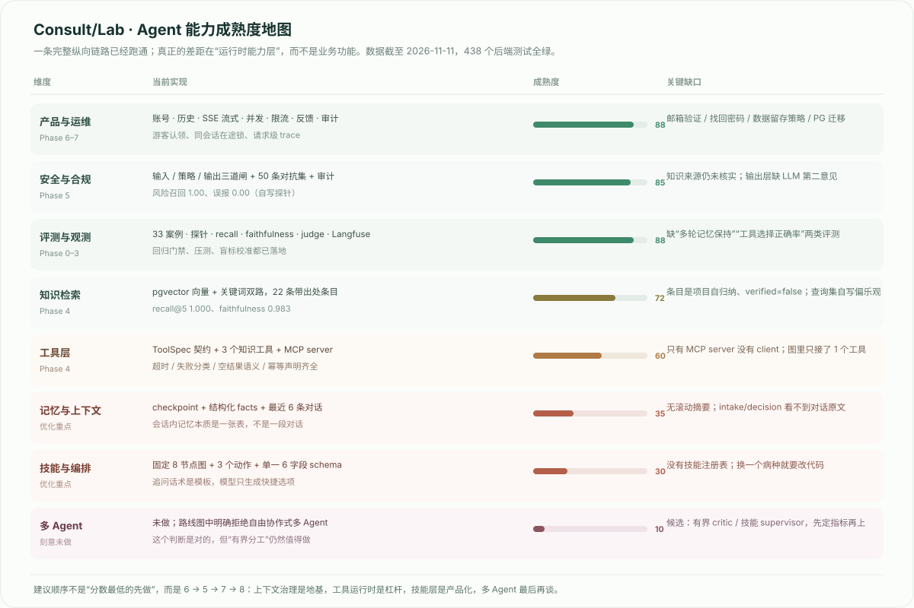
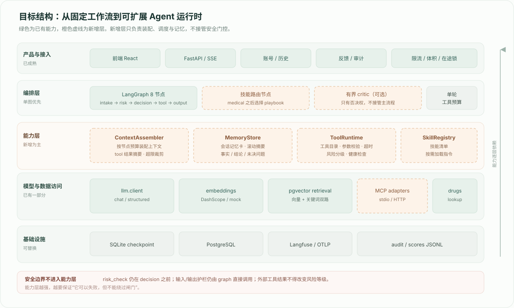

# Agent 能力层优化路线图

> 适用对象：Consult/Lab v0.1.x（Phase 7 产品化之后）
> 编写日期：2026-11-11
> 文档定位：讨论 Agent 运行时能力（工具、记忆、上下文、技能、多 Agent），不改变医疗安全边界
> 当前基线：438 个后端测试通过；33 条案例；正式检索 recall@5 = 1.000、faithfulness = 0.983

---

## 0. 一页结论

**当前系统不是"不完整的 Agent"，而是"一个扎实的领域工作流 + 一个尚未成型的通用 Agent 运行时"。**

纵向链路已经完整：输入护栏 → intake → risk_check → 预路由 → decision → followup/tool → output/answer → checkpoint → SSE → 前端。每一段都有测试、有 trace、有降级路径。

但横向能力参差：

| 方向 | 当前状态 | 目标状态 | 优先级 |
| --- | --- | --- | --- |
| 外部 MCP 工具 | 只有 MCP server，没有 client；图里只接了 1 个工具 | 工具目录 + 动态选择 + 外部工具接入 | P2 |
| Memory files | checkpoint + 结构化字段 + 最近 6 条对话 | 会话记忆卡 + 滚动摘要 + 版本化提示词文件 | P1 |
| 上下文长度 | 无预算、无装配层；对话只增不减 | 按节点预算装配，工具结果先摘要 | P1 |
| Skills | 一套全局字段与话术 | 技能注册表 + 按需加载 + 按技能评测 | P3 |
| 多 Agent | 刻意未做 | 有界 critic / 技能路由，先定指标再上 | P4 |

**推荐顺序：评测补齐 → 上下文与记忆 → 工具运行时 → 技能层 → 有界多 Agent。**
合规核验（知识来源、药品说明书）与账号闭环并行推进，不占这条主线的位置。

为什么不是先接 MCP、先上多 Agent：这两个方向都会放大上下文压力和不可复现性，而当前系统还没有衡量它们的指标。先补底座，后加能力。

---

## 1. 现状盘点

### 1.1 已经具备的能力

| 层 | 实现 | 代码位置 | 证据 |
| --- | --- | --- | --- |
| 模型接入 | 统一 OpenAI 兼容客户端，instructor 结构化输出，失败降级 | [llm/client.py](../../backend/app/llm/client.py) | 7 条离线测试 + 真实调用 |
| 信息抽取 | 模型抽取 + 证据闸门 + 否定闸门 + 关键词兜底 | [agent/intake_llm.py](../../backend/app/agent/intake_llm.py) | 抽取 F1 0.93 |
| 决策 | 模型在三动作中提议，置信度闸门，策略覆盖，程序校验 | [agent/decision.py](../../backend/app/agent/decision.py) | 113+ 测试 |
| 工具契约 | ToolSpec + ToolResult，超时、失败分类、空结果语义、幂等声明 | [tools/contract.py](../../backend/app/tools/contract.py) | 契约测试 |
| 知识检索 | pgvector 向量 + 关键词双路，加权融合，带出处 | [knowledge/retrieval.py](../../backend/app/knowledge/retrieval.py) | recall@5 1.000 |
| 分层安全 | 输入护栏、策略层、输出复核、审计、对抗集 | [safety/](../../backend/app/safety) | 红旗召回 1.00、误报 0.00 |
| 可观测性 | span 树、JSONL / Langfuse 双 sink、采集端脱敏 | [observability/](../../backend/app/observability) | 会话级 trace |
| 评测 | 33 案例、探针、judge、红队、压测、门禁 | [eval/](../../eval) | 回归 CI |
| 产品化 | 账号、历史、SSE、并发、限流、体积边界、反馈 | [api/routes.py](../../backend/app/api/routes.py) | 438 测试 |
| 前端 | 登录注册、历史抽屉、流式、结果卡、快捷选项 | [frontend/src/App.jsx](../../frontend/src/App.jsx) | 浏览器端到端验证 |

### 1.2 四个结构性事实

这四个事实决定了后续所有工作的起点。

**事实一：decision 的动作空间只有 3 个，工具只有 1 个真正接入图。**

- [graph.py:160](../../backend/app/agent/graph.py:160) 写死 `KNOWLEDGE_TOOL_NAME = DEPARTMENT_ROUTE`。
- [decision_llm.py](../../backend/app/agent/decision_llm.py) 的 `DecisionChoice` 只有 `action`，没有 `tool_name` / `tool_args`。
- [decision.py:43](../../backend/app/agent/decision.py:43) 和 [decision.py:100](../../backend/app/agent/decision.py:100) 用 `"department_route" in state.tool_results` 判断工具是否调用。
- `red_flag_lookup` 与 `guideline_retrieve` 只被 MCP server 暴露，内部 Agent 从未调用。

工具层"看起来有了"，实际只用了三分之一。这是接入外部 MCP 之前必须先解决的结构问题。

**事实二：会话内的记忆本质是一张表，不是一段对话。**

- [intake.py](../../backend/app/agent/intake.py) 只把当前消息交给抽取器。
- [decision_llm.py](../../backend/app/agent/decision_llm.py) 只看结构化字段、证据、缺失项和已问问题。
- 只有 [answer.py:126](../../backend/app/agent/answer.py:126) 用了 `conversation[-6:]`。

用户说"还是刚才那个位置"时，intake 和 decision 都不知道"刚才"指什么。这是"状态驱动"的有意取舍，但它决定了记忆层的上限。

**事实三：上下文没有治理机制。**

- `conversation` 是 `Annotated[list, operator.add]`，只增不减（[state.py:36](../../backend/app/agent/state.py:36)）。
- `trace` 已经截断到 80 条，说明设计者意识到状态会膨胀；但对话没有对应策略。
- 没有发送前的 token 预算；只有事后的 usage 统计。
- `_query_from_facts` 把所有事实拼成一条检索问句，字段一多就会变噪。

实测当前检查点：477 个 checkpoint，总计 1.26MB，单条最大 8KB。**现在没有上下文危机**，但接入工具和技能后会迅速恶化。

**事实四：提示词是代码，不是资产。**

6 个模块里的 system prompt 都是 Python 字符串，靠手工 `PROMPT_NAME` / `PROMPT_VERSION` 维护。这为观测提供了基础，但无法 diff、评审、按版本回滚，也无法按技能组合。这是技能层的前置障碍。

### 1.3 能力成熟度地图



### 1.4 当前规模

| 项目 | 数值 |
| --- | --- |
| 后端应用代码 | 约 8,000 行，52 个模块；其中 agent 模块 14 个 |
| 后端测试 | 438 passed |
| 图节点 | 8 个，3 个动作 |
| 契约化工具 | 3 个，接入图 1 个 |
| 知识条目 | 22 条，出处 `verified=false` |
| 药品说明书 | 19 条，未核实 |
| 评测案例 | 33 条固定案例 + 探针 + 对抗集 |
| 检查点 | 477 个，1.26MB，单条最大 8KB |

---

## 2. 目标架构

### 2.1 分层结构



核心变化不是重写图，而是在图与基础设施之间增加一层**能力层**：

```
编排层（LangGraph 8 节点 + 技能路由 + 可选 critic）
        ↓
能力层（ContextAssembler / MemoryStore / ToolRuntime / SkillRegistry）
        ↓
模型与数据访问（llm.client / embeddings / pgvector / MCP adapters）
        ↓
基础设施（SQLite checkpoint / PostgreSQL / Langfuse / audit JSONL）
```

### 2.2 五个核心接口

新增层只做装配与调度，不承载业务规则，也不接管安全门控。

#### ContextAssembler

**职责：** 按节点声明和预算，把 state 转成这次调用要发的消息。
**不负责：** 生成文案、做决策、判断安全。

输入是节点名、state 和预算配置，输出是 `messages` 与一份 token 估算记录。每个节点只声明"我要哪些 section"，不再自己拼接 JSON。

#### MemoryStore

**职责：** 维护会话记忆卡（已确认事实、已给结论、未决问题、最近话题）与滚动摘要。
**不负责：** 跨会话的原始对话存储；不做用户画像。

记忆卡是人和模型都能读的紧凑结构，每轮更新，可随 checkpoint 持久化。

#### ToolRuntime / ToolCatalog

**职责：** 工具注册、目录查询、风险分级、参数校验、超时执行、结果摘要、健康检查。
**不负责：** 决定该不该调用工具；安全闸门不读工具结果做放行。

工具描述里增加 `risk_class`（read-only / write / external / sensitive）和 `scope`（internal / external）。目录只暴露当前技能允许的工具。

#### SkillRegistry

**职责：** 技能清单、路由所需摘要、按需加载完整指令与配置。
**不负责：** 替代知识库。技能是程序性知识，RAG 是声明性知识。

技能包包含：适用条件、字段 schema、追问优先级、工具白名单、输出模板、评测集。

#### Orchestrator

**职责：** 保持单图拓扑，增加技能路由节点和可选 critic 节点。
**不负责：** 引入第二套编排框架。

### 2.3 五条设计原则

1. **能力层可以失败，但不能绕过闸门。** 外部工具结果不得改变风险等级；risk_check 仍在 decision 之前。
2. **先目录，后协议。** 先把"有哪些工具、怎么选、怎么执行"做对，再接 MCP client。
3. **先指标，后实现。** 每个新增能力必须回答"改完哪个数字应该变"。
4. **默认降级。** 记忆、工具、技能任一环节失败，主流程仍能走完。
5. **保持单图。** 不引入 CrewAI / AutoGen；多 Agent 只做有界分工。

---

## 3. 分阶段路线

### Phase A｜先补评测标尺（2–3 天）

**工程问题：** 现有指标衡量的是抽取、风险、检索和流程正确性，无法衡量"记忆是否保持""工具是否选对""技能是否路由正确"。没有这些数字，后面每一层都无法证明有效。

**概念：** 上下文与工具类能力，不能只看最终回答。要构造"必须依赖中间状态才能答对"的题，才能测出系统是否真的记住了、选对了。

**改动清单：**

| 文件 | 内容 |
| --- | --- |
| `eval/context_retention.py` | 10 条 8–12 轮会话，第 1 轮埋关键事实，末轮问依赖该事实的问题 |
| `eval/tool_selection.py` | 20 条需要不同工具与参数的单轮场景，记录期望工具与实际调用 |
| `eval/token_ledger.py` | 从 trace 汇总每轮输入/输出 token、按节点分组的 p50/p95 |
| `eval/skill_routing.py` | 先留占位；Phase D 前填入每技能 10 条路由样本 |

**指标定义见第 4 节。**

**验收标准：**

- 四个脚本都能在 mock 模式下离线运行。
- 输出 JSONL + Markdown 摘要，能进入 CI 门禁。
- 基线值写入 `docs/metrics-log.md`。
- 不新增任何业务依赖。

**降级/回滚：** 纯评测脚本，不影响运行时；失败只影响 CI。

---

### Phase B｜上下文装配与会话记忆（4–6 天）

> 进展（2026-11-11）：记忆指代路由已修；会话记忆卡（`memory/session_memory.py`）、字符预算（`context/budget.py`）与 answer 上下文装配（`context/assembler.py`）已落地，prompt 升到 v5。M6 模型复测：远距对话 `answer` 0.000 → 1.000、`prompt` 0 → 1.000，`window` 仍为 0.333，说明信息来自记忆卡而非更大窗口。decision 已接入参考上下文（prompt v2）；intake 保持解析器边界，只吃本轮原话。M1 在当前模型下重测为 **0.877**（旧 0.9325 已不可比）；参考上下文与字段归属 guidance 均未带来稳定提升，已回退到 v2。新增只读导出视图 `GET /sessions/{id}/memory`（结构化 + Markdown）与前端「查看记忆」弹层。另新增 M11 general/medical 路由评测：router v2 修正饮食/生活方式误判，dev 与 holdout 均 1.000。长会话滚动摘要已落地：最近窗口外累计 12 条触发、摘要 ≤300 字、失败保留旧摘要并重试；记忆卡 8×90 细节 + 300 字摘要，最坏约 1.44K 字符。新增长会话评测 LS01（24 轮 dev）与 LS02（20 轮 holdout），**两套均 3/3 探针命中**，且第 12/16 轮为 `summary=✓ / details=✗ / window=✗`。剩余：按技能的记忆隔离、阶段末重复采样。剩余：长会话滚动摘要、按技能的记忆隔离。

**工程问题：** 每个节点各自拼 prompt，没有统一预算；intake 和 decision 看不到对话原文；对话只增不减。接入工具和技能后，prompt 会从"小而准"变成"大而杂"。

**概念：**

> 上下文不是"塞得越多越好"，而是"在正确的节点给正确的切片"。

三个切片要分开：

1. **事实切片**：结构化字段与证据。给 intake、decision、output。
2. **记忆切片**：会话记忆卡 + 最近 N 轮原文。给 answer、decision。
3. **知识切片**：检索命中的条目摘要。给 output、answer。

上下文装配层的工作，是为每个节点声明预算和优先级，超预算时按"安全相关 > 当前轮 > 历史摘要 > 早期原文"的顺序裁剪。

**改动清单：**

| 文件 | 内容 |
| --- | --- |
| `backend/app/context/budget.py` | 节点预算表与 token 估算（中文按字符近似即可，先不引 tokenizer） |
| `backend/app/context/assembler.py` | `assemble(node, state, memory) -> messages`，各节点只声明 section |
| `backend/app/memory/session_memory.py` | 记忆卡结构：已确认事实、已给结论、未决问题、最近话题 |
| `backend/app/memory/store.py` | 读写记忆卡；随 checkpoint 持久化，不另建表 |
| `backend/app/agent/state.py` | 增加 `session_memory`、`context_ledger` 字段 |
| `backend/app/agent/intake.py` | 装配时带上记忆卡中的"未决问题"和最近用户原话 |
| `backend/app/agent/decision_llm.py` | 装配时带上记忆卡摘要，不再只给字段 |
| `backend/app/agent/router.py` | 记忆指代问题（“我刚才说……”“之前提到的……”）必须走带记忆的 answer 节点，或在 router prompt 注入记忆卡摘要 |
| `backend/app/agent/answer.py` | 用装配层取“记忆卡 + 最近 6 条”，替代直接切片 |
| `backend/app/agent/graph.py` | 每轮结束前更新记忆卡；节点不直接拼 prompt |

**记忆卡示例：**

```json
{
  "confirmed": {"主要症状": ["头痛"], "持续时间": ["两天"], "部位": ["前额"]},
  "conclusion": {"department": "神经内科", "source": "K-012", "status": "completed"},
  "open_questions": ["是否伴随恶心"],
  "recent_topic": "挂号流程",
  "turns": 4
}
```

**验收标准：**

- M6 上下文保持率 ≥ 0.90；对话类样本 `bypass = 0`、`否认回忆 = 0`（记忆指代问题必须走记忆路径）。
- M8 每轮输入 token p95 不超过预算的 110%。
- 记忆卡在 12 轮会话后仍小于 1.5KB。
- 现有 438 个测试全绿；33 案例在 mock 与模型模式下不回退。
- 任一记忆读写失败时，节点回退到当前行为，不抛 500。

**降级/回滚：** 记忆卡写入失败只记 trace，不阻断；装配层保留 `legacy` 开关，可一键回退到原拼接逻辑。

---

### Phase C｜工具运行时与 MCP client（5–7 天）

> 进展（2026-11-13）：Phase C 验收项已全部落地——工具目录与风险分级、决策层选工具与预算、工具结果摘要（≤400 字）、stdio/HTTP MCP client、`red_flag_lookup` 红旗科普场景、外部工具失败降级“暂无依据”。另外接入 10 个真实外部 MCP 工具（托管 HTTP）：openFDA（说明书/召回/短缺/批准/不良反应）、ClinicalTrials.gov（检索/详情）、PubMed（检索/摘要）、MedlinePlus（疾病科普），各有确定性路径、专用摘要和剂量过滤；`USE_MODEL=1` 时所有外部结果统一经中文摘要层（保留编号与来源），MedlinePlus 健康主题会抓取页面正文做 2–3 句摘要。剩余两项低优先级回滚开关未做：`tool_results` 按调用序号记历史、`TOOL_RUNTIME=legacy`。

**工程问题：** 工具契约已经很完整，但决策层不会选工具、不会传参数；外部 MCP 工具没有入口；工具结果没有摘要；多个工具之间没有调用预算。

**概念：**

> MCP 是工具接入的边界，不是编排模型。

它解决"工具如何被标准化描述与调用"，不解决"该不该让模型自由选工具"。医疗场景里，工具必须先分风险等级：

| 风险等级 | 例子 | 策略 |
| --- | --- | --- |
| read-only / internal | 知识检索、科室方向 | 可按模型选择自动执行 |
| read-only / external | 公开指南检索、药品说明书查询 | 需白名单 + 超时 + 结果摘要 |
| write / external | 预约、发消息、写档案 | 必须人工确认，不进入自动决策 |
| sensitive | 用户身份、支付、定位 | 默认不接入 |

**改动清单：**

| 文件 | 内容 |
| --- | --- |
| `backend/app/tools/catalog.py` | `ToolCatalog`：注册、按技能过滤、按风险等级过滤、描述导出 |
| `backend/app/tools/risk_class.py` | `risk_class` / `scope` 枚举与校验 |
| `backend/app/tools/mcp_client.py` | stdio / streamable HTTP 适配器，把外部工具注册进目录 |
| `backend/app/llm/schemas.py` | `DecisionChoice` 增加 `tool_name`、`tool_args` |
| `backend/app/agent/decision_llm.py` | prompt 注入当前可用工具清单与参数 schema 摘要 |
| `backend/app/agent/decision.py` | 校验工具名、参数、风险等级、调用预算；不再硬编码 `department_route` |
| `backend/app/agent/graph.py` | tool 节点改为按 `tool_name` 查表执行；支持多工具调用记录 |
| `backend/app/agent/state.py` | `tool_results` 改为按调用序号记录，保留调用历史 |
| `backend/app/tools/knowledge_tools.py` | 为三个工具补 `risk_class` 与结果摘要函数 |

**关键接口草图：**

```python
class CatalogEntry(BaseModel):
    name: str
    description: str
    params_model: type[BaseModel]
    risk_class: Literal["read_only", "write", "sensitive"]
    scope: Literal["internal", "external"]
    timeout_s: float
    summarize: Callable[[dict], str]   # 结果进上下文前先摘要
```

**验收标准：**

- M7 工具选择正确率 ≥ 0.90；危险工具误调次数 = 0。
- `red_flag_lookup` 与 `guideline_retrieve` 至少各有一个真实使用场景接入图。
- 外部工具超时 / 不可用时，返回结构化 error，主流程降级为"暂无依据"。
- 工具结果进入上下文前被摘要到不超过 400 字。
- 单轮工具调用有硬上限（建议 3 次），超过后强制 FINALIZE。
- 现有工具契约测试与 MCP 协议测试保持全绿。

**降级/回滚：** `TOOL_RUNTIME=legacy` 回退到单工具路径；外部 MCP 默认关闭，按配置逐个启用。

---

### Phase D｜技能层（5–7 天）

**工程问题：** 全局一套 6 字段 schema、一套追问模板、一套输出格式。换一个病种（儿童发热、皮疹、用药咨询）就要改代码，且没有按技能的评测。

**概念：**

> 技能是程序性知识：这类病人该怎么问、按什么顺序问、什么时候停。
> RAG 是声明性知识：这个症状对应什么科室、有什么红旗。

技能包建议结构：

```
skills/headache/
  SKILL.md          # 何时使用、问诊策略、禁忌
  manifest.yaml     # 字段 schema、追问优先级、工具白名单、输出模板
  examples.jsonl    # 少样本
  eval.jsonl        # 技能评测集
```

**改动清单：**

| 文件 | 内容 |
| --- | --- |
| `prompts/` | 把 6 个模块的 system prompt 迁成版本化文本文件 |
| `skills/_schema.py` | manifest Pydantic 模型与校验 |
| `backend/app/skills/registry.py` | 扫描技能目录、加载 manifest、导出路由摘要 |
| `backend/app/skills/router.py` | 在 medical 路由之后选择技能；模型 + 规则双路径 |
| `backend/app/agent/graph.py` | 增加 `skill_route` 节点；技能影响字段与追问优先级 |
| `backend/app/agent/intake.py` | 按技能 schema 计算必需字段 |
| `backend/app/agent/followup.py` | 按技能追问优先级与话术生成问题 |
| `backend/app/agent/result.py` | 按技能输出模板渲染 |
| `eval/skill_routing.py` | 每技能 10 条路由样本 |

**渐进披露：**

路由时只给模型每个技能的一行摘要；选中后才加载完整 `SKILL.md` 与少样本。否则技能一多，prompt 立刻爆。

**验收标准：**

- M9 技能路由准确率 ≥ 0.90。
- 至少落地 2 个技能：`headache`（现有能力迁移）与 `pediatric_fever`（新增），验证切换不互相污染。
- 每技能独立评测集，主案例集不回退。
- 技能加载失败时回退到默认技能，不阻断问诊。
- `prompts/` 迁移后，观测中的 `prompt.version` 仍能对应到文件版本。

**降级/回滚：** 默认技能等价于当前行为；`SKILLS_ENABLED=0` 可完全关闭。

---

### Phase E｜有界多 Agent（3–5 天，可选）

**工程问题：** 单模型输出仍可能越界、编造依据或制造焦虑。现有规则 + guardrails 覆盖了高确定性模式，但对语义变体仍有漏判。

**概念：** 多 Agent 分三类，不能混为一谈：

| 类型 | 例子 | 建议 |
| --- | --- | --- |
| 自由协作 | CrewAI 角色互聊 | 不做 |
| Supervisor / 路由 | 技能选择、任务分派 | 作为图节点实现，不需要多 Agent 框架 |
| 有界专家 / 审查者 | critic、verifier、第二意见 | 值得做，但必须有硬约束与指标 |

**改动清单：**

| 文件 | 内容 |
| --- | --- |
| `backend/app/agent/critic.py` | 输出审查节点：越界、编造依据、制造焦虑三类检查 |
| `backend/app/agent/graph.py` | output/answer 之后可选的 critic 边；只有否决权 |
| `eval/critic_gain.py` | 对比上线前后红队漏判率、误杀率与 p95 增量 |

**critic 的硬约束：**

1. 只返回 `pass` / `block` / `rewrite_hint`，不生成最终文案。
2. `block` 时走现有安全兜底，不新增话术。
3. 超时或失败视为 `pass`（不能成为单点故障），同时记 trace。
4. 默认关闭，按技能或按风险等级开启。

**验收标准：**

- 红队漏判率相对下降 ≥ 30%，误杀率 ≤ 2%。
- p95 增量 ≤ 800ms（模型模式）。
- 关闭 critic 时行为与当前完全一致。
- 每个 `block` 都有审计记录与 trace。

**降级/回滚：** `CRITIC_ENABLED=0` 即回到当前链路。

---

### Phase F｜产品与合规收尾（并行，不占主线）

这些不是 Agent 能力，但决定产品能不能上线，优先级高于 Phase C–E。

| 事项 | 当前问题 | 完成标准 |
| --- | --- | --- |
| 知识来源核验 | 22 条条目全部 `verified=false`，项目自归纳 | 换成可核实的公开文件，逐条置 `true` |
| 药品说明书核验 | 19 条 OTC 示例说明书未核实 | 官方说明书 + 药师审核；保留版本与日期 |
| 数据留存与知情同意 | 未定义保留期、删除路径、导出能力 | 隐私说明 + 一键删除 + 保留期配置 |
| 账号闭环 | 无邮箱验证、无找回密码 | 完成注册验证与重置流程 |
| 服务可靠性 | SQLite 单机；工具无重试 | 工具重试/熔断；明确 PG 迁移触发条件 |

PostgreSQL 迁移的触发条件保持原判断：多实例部署，或并发写导致 p95 明显恶化。不要为了"看起来生产级"提前迁移。

---

## 4. 指标定义

| 编号 | 指标 | 计算方式 | 目标 | 工具 |
| --- | --- | --- | --- | --- |
| M6 | 上下文保持率 | 10 条 8–12 轮会话，末轮回答正确引用第 1 轮事实的比例 | ≥ 0.90 | `eval/context_retention.py` |
| M7 | 工具选择正确率 | 期望工具与参数均正确的样本比例 | ≥ 0.90；危险误调 0 | `eval/tool_selection.py` |
| M8 | 每轮输入 token | 按节点汇总 trace 中的 `gen_ai.usage.input_tokens`，报告 p50/p95 | p95 ≤ 预算 × 1.1 | `eval/token_ledger.py` |
| M9 | 技能路由准确率 | 每技能 10 条样本，路由到正确技能的比例 | ≥ 0.90 | `eval/skill_routing.py` |
| M10 | critic 净收益 | 红队漏判率下降幅度 / p95 增量 | 漏判降 ≥ 30%，p95 +≤ 800ms | `eval/critic_gain.py` |

补充原则：

- 新指标必须先有基线，再进入实现。
- 每次改动在 `docs/metrics-log.md` 追加一行"改了什么 → 哪个数字变了"。
- 主案例集（33 条）与各专项集分开报告，避免一个总分掩盖退化。

---

## 5. 设计决策记录

### ADR-1｜为什么不是先接 MCP

**决策：** 先做工具目录、动态选择与参数生成，再接 MCP client。
**理由：** 当前缺的不是工具数量，而是"选择工具的能力"。直接接 10 个外部 MCP，只会让 3 动作 schema 更不够用、prompt 更乱、安全边界更模糊。
**代价：** 外部工具接入晚 1–2 周。
**复审条件：** 如果业务先需要"公开指南检索"这类只读外部能力，可以提前做一个单工具试点，但不改变目录先行。

### ADR-2｜为什么不做自由协作式多 Agent

**决策：** 不引入 CrewAI / AutoGen；只做图内的有界分工。
**理由：** 医疗场景的核心卖点是确定性门控与可审计轨迹。自由协作会引入不可复现的分支，削弱安全性论证。
**代价：** 复杂任务的分工能力有限。
**复审条件：** 当工具数量超过 8 个、且单 Agent 的工具选择准确率明显下降时，再评估检索子 Agent。

### ADR-3｜为什么跨会话记忆只做档案卡

**决策：** 不做原始对话的跨会话记忆；只做用户显式同意下的健康档案卡。
**理由：** 医疗场景里，长期记忆是隐私与幻觉风险源。用户上一次的症状不应该被自动当成这一次的事实。
**代价：** 跨会话体验较弱。
**复审条件：** 有明确的用户需求与合规方案后，再做可关闭的档案卡。

### ADR-4｜为什么 skills 不是 RAG

**决策：** 技能放程序性知识（怎么问），知识库放声明性知识（对应什么科室）。
**理由：** 两者生命周期不同。技能随产品策略变化，知识随医学证据变化。混在一起会导致"改问诊流程"和"改医学事实"互相牵连。
**代价：** 需要维护两套内容与两套评测。

### ADR-5｜为什么新增能力不能绕过安全闸门

**决策：** risk_check 保持在 decision 之前；输入/输出护栏仍由 graph 直接调用；外部工具结果不得改变风险等级。
**理由：** 能力层越强，越要保证"它可以失败，但不能绕过闸门"。
**代价：** 某些"更智能"的路径会被闸门拦住。
**复审条件：** 无。这是硬约束。

### ADR-6｜为什么保持单图

**决策：** 继续用 LangGraph 单图，不引入第二套编排框架。
**理由：** 现有拓扑、checkpoint、SSE、trace 都围绕单图构建；换框架的收益低于迁移成本。技能与 critic 都可以作为节点或子图加入。
**代价：** 图的节点数会增加，需要控制复杂度。

---

## 6. 风险登记册

| 风险 | 表现 | 对策 |
| --- | --- | --- |
| 范围蔓延 | 五个方向同时开工，每个都做一半 | 一次只推进一个 Phase；每个 Phase 有独立验收 |
| 上下文装配过度设计 | 引入复杂 tokenizer 与抽象层，收益不明显 | 先用字符近似估算；以 M8 和 M6 为准，不追求理论最优 |
| 记忆卡变成第二份真相 | 记忆卡与 collected_facts 不一致 | 记忆卡只读派生，不独立写入；以 state 为准 |
| 工具目录失控 | 外部工具越多，模型越容易乱选 | 按技能白名单过滤；单轮调用上限；危险工具不进目录 |
| MCP 外部依赖不稳定 | 外部 server 超时拖垮主流程 | 默认关闭、独立超时、熔断、失败降级为"暂无依据" |
| 技能路由错误 | 儿科病人走进成人技能 | 规则兜底 + 每技能评测 + 路由置信度低时回默认技能 |
| critic 成为单点故障 | 模型超时导致整轮失败 | 失败视为 pass；默认关闭；按技能开启 |
| 合规滞后 | 能力做完了，但来源仍未核实 | Phase F 与主线并行；上线门禁包含来源核验 |
| 评测过拟合 | 只对固定案例调 prompt | 保留 holdout；新增能力用新构造的评测集 |

---

## 7. 两周切片

### 第 1 周：标尺与上下文

| 天 | 任务 | 产物 |
| --- | --- | --- |
| 1 | 定义 M6–M9，写基线 | `eval/*.py` 骨架 + `metrics-log.md` |
| 2 | 实现 `ContextAssembler` 与预算表 | `context/assembler.py`、`context/budget.py` |
| 3 | 实现记忆卡与读写 | `memory/session_memory.py`、`memory/store.py` |
| 4 | 接入 intake / decision / answer | 三个节点改为装配取上下文 |
| 5 | 跑 M6 / M8，修退化 | 指标报告 + 全量测试 |

### 第 2 周：工具运行时

| 天 | 任务 | 产物 |
| --- | --- | --- |
| 1 | `DecisionChoice` 增加工具名与参数 | schema + prompt 注入 |
| 2 | 实现 `ToolCatalog` 与风险分级 | `tools/catalog.py`、`tools/risk_class.py` |
| 3 | tool 节点改为按目录执行，加调用预算 | graph 改造 + 测试 |
| 4 | 接入 `red_flag_lookup` / `guideline_retrieve` | 两个真实使用场景 |
| 5 | 跑 M7，补工具选择评测 | 指标报告 + 全量测试 |

两周结束后再决定是否进入 Phase D。不要提前开始技能层。

---

## 8. 完成定义

一个 Phase 只有同时满足以下条件才算完成：

- [ ] 指标有基线、有变化、有记录。
- [ ] 新增能力有降级路径，关闭开关后行为与之前一致。
- [ ] 现有 438 个测试全绿；33 条案例不回退。
- [ ] 新增模块有单元测试，关键失败路径有覆盖。
- [ ] trace 中有足够信息定位"模型看到了什么、为什么这么选"。
- [ ] 没有新增未锁定的运行时依赖。
- [ ] 安全边界没有被放宽；审计仍能回答每一次升级。

---

## 附录 A｜文件改动地图

### 新增

| 路径 | 用途 |
| --- | --- |
| `backend/app/context/budget.py` | 节点预算与 token 估算 |
| `backend/app/context/assembler.py` | 上下文装配 |
| `backend/app/memory/session_memory.py` | 记忆卡结构 |
| `backend/app/memory/store.py` | 记忆卡读写 |
| `backend/app/tools/catalog.py` | 工具目录 |
| `backend/app/tools/risk_class.py` | 工具风险分级 |
| `backend/app/tools/mcp_client.py` | MCP 客户端适配 |
| `backend/app/skills/registry.py` | 技能注册表 |
| `backend/app/skills/router.py` | 技能路由 |
| `backend/app/agent/critic.py` | 有界输出审查 |
| `prompts/` | 版本化提示词 |
| `skills/` | 技能包 |
| `eval/context_retention.py` | M6 |
| `eval/tool_selection.py` | M7 |
| `eval/token_ledger.py` | M8 |
| `eval/skill_routing.py` | M9 |
| `eval/critic_gain.py` | M10 |

### 修改

| 路径 | 改动 |
| --- | --- |
| `backend/app/agent/state.py` | 增加记忆卡与上下文账本字段 |
| `backend/app/agent/graph.py` | 技能路由节点、通用 tool 节点、可选 critic 边 |
| `backend/app/agent/decision_llm.py` | 决策 schema 与工具目录注入 |
| `backend/app/agent/decision.py` | 多工具校验与调用预算 |
| `backend/app/agent/intake.py` | 按技能 schema 计算字段 |
| `backend/app/agent/followup.py` | 按技能优先级与话术追问 |
| `backend/app/agent/answer.py` | 使用装配层上下文 |
| `backend/app/agent/result.py` | 按技能模板渲染 |
| `backend/app/config.py` | 新增开关：`TOOL_RUNTIME`、`SKILLS_ENABLED`、`CRITIC_ENABLED` |
| `docs/metrics-log.md` | 每阶段指标变化 |

---

## 附录 B｜术语表

| 术语 | 含义 |
| --- | --- |
| 工作记忆 | 当前轮可直接使用的结构化事实与最近对话 |
| 情节记忆 | 一次问诊的过程与结论摘要 |
| 语义记忆 | 可检索的领域知识库 |
| 程序性知识 | 怎么问、按什么顺序问、何时停止（技能） |
| 声明性知识 | 症状对应什么科室、有哪些红旗（知识库） |
| 上下文装配 | 按节点预算选择并裁剪输入切片 |
| 有界多 Agent | 有明确职责、硬约束与否决边界的角色分工 |
| 渐进披露 | 先给摘要，选中后再加载完整指令 |

---

## 附录 C｜关键代码入口

| 主题 | 入口 |
| --- | --- |
| 图拓扑 | [backend/app/agent/graph.py](../../backend/app/agent/graph.py) |
| 状态定义 | [backend/app/agent/state.py](../../backend/app/agent/state.py) |
| 决策 | [backend/app/agent/decision.py](../../backend/app/agent/decision.py)、[decision_llm.py](../../backend/app/agent/decision_llm.py) |
| 回复生成 | [backend/app/agent/answer.py](../../backend/app/agent/answer.py) |
| 工具契约 | [backend/app/tools/contract.py](../../backend/app/tools/contract.py) |
| 工具注册 | [backend/app/tools/registry.py](../../backend/app/tools/registry.py) |
| MCP server | [backend/app/tools/mcp_server.py](../../backend/app/tools/mcp_server.py) |
| 知识检索 | [backend/app/knowledge/retrieval.py](../../backend/app/knowledge/retrieval.py) |
| 模型客户端 | [backend/app/llm/client.py](../../backend/app/llm/client.py) |
| 安全策略 | [backend/app/safety/policy.py](../../backend/app/safety/policy.py) |
| 观测 | [backend/app/observability/tracer.py](../../backend/app/observability/tracer.py) |
| 评测 | [eval/run_eval.py](../../eval/run_eval.py) |
