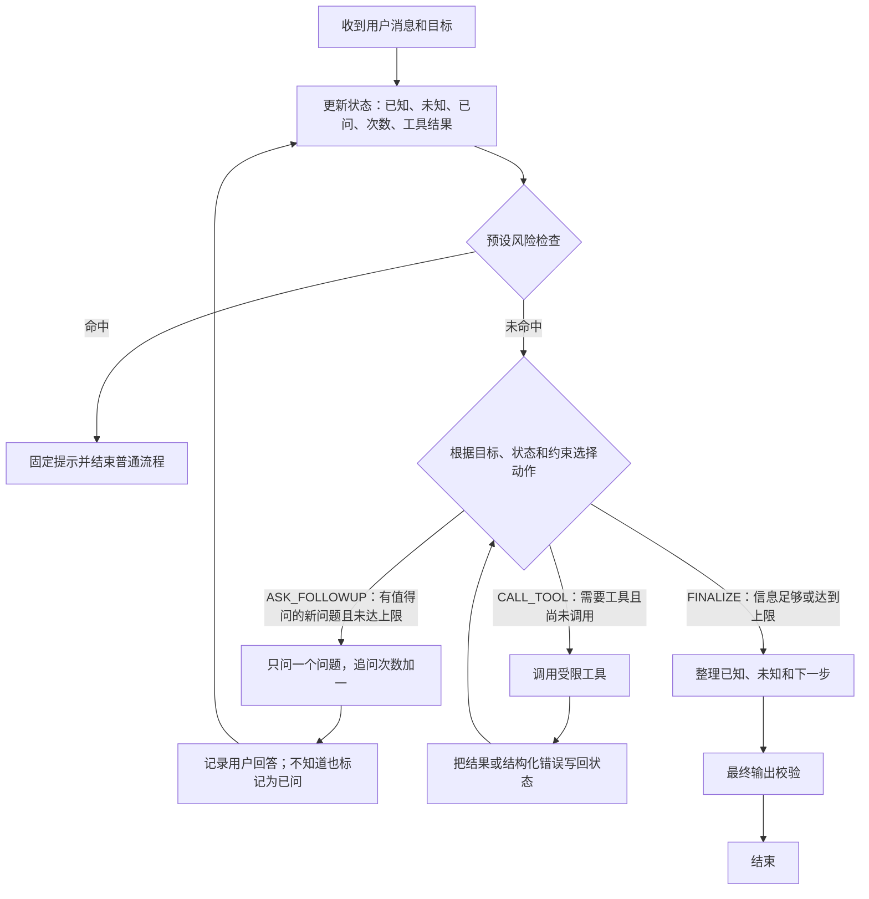

# Day 1｜Agent 基础与手工轨迹

> 本页只用于求职作品的流程学习。案例均为虚构，不用于真实问诊、诊断或用药指导。

## 1. 我们要学的最小闭环

Agent 接收一个目标，读取当前状态，在允许的动作中选择下一步，执行后记录观察结果，再决定继续或结束。

```text
目标 → 读取状态 → 选择动作 → 执行 → 记录观察结果
           ↑                         │
           └──── 未完成时继续 ────────┘
```

| 类型 | 决定下一步的方式 | 本项目中的例子 |
| --- | --- | --- |
| Chatbot | 根据当前输入直接生成回答 | 对一句描述直接回复文本 |
| Workflow | 预先写好固定执行顺序 | 每次都按相同顺序问三个问题 |
| Agent | 根据目标和当前状态，在受限动作中选择下一步 | 信息缺失时追问；信息足够时调用工具或结束 |

本项目允许的核心动作是 `ASK_FOLLOWUP`、`CALL_TOOL` 和 `FINALIZE`。模型负责在约束内选择动作；程序负责校验动作、执行受限工具、保存状态并控制停止条件。预设风险检查独立于模型决策。

## 2. 状态、历史与轨迹

| 名称 | 记录内容 | 用途 |
| --- | --- | --- |
| 状态（state） | 当前目标、已知事实、未知字段、已问问题、追问次数、工具结果、下一动作 | 决定下一步 |
| 对话历史（history） | 每轮对话的原话 | 保留上下文；需要提取成状态后才能可靠地参与决策 |
| 执行轨迹（trace） | 每一步读取了什么状态、选择了什么动作、得到什么结果 | 排错和评测 |

“不知道”也是一次有效回答：该字段仍为未知，但问题要记入 `asked_questions`，避免原样重复。`followup_count` 在**发出追问时**增加，而不是在收到回答时增加。

## 3. 面向模拟病例的流程



除追问上限外，还要设置最大总步数，防止工具失败或动作选择异常导致无限循环。最终输出不能包含确定诊断、处方、剂量或停药建议。风险门控只是针对预设模拟案例的工程边界，不代表临床可靠性。

## 4. 手工轨迹 A：信息不足，用户回答“不知道”

以下内容只演示状态如何变化，不对描述作医学判断。每条新消息都应先经过预设风险检查；表中的普通流程以该检查未命中为前提。

| 步骤 | 观察与状态变化 | 下一动作 |
| --- | --- | --- |
| 初始 | 虚构输入：“这两天头部不适”。已知主要描述和持续时间；部位、程度、其他表现未知；追问 `0/3`。 | `ASK_FOLLOWUP`：只问一次具体部位。 |
| 第一次回答 | “说不清具体位置”。部位仍未知；记录“部位已问”；追问已为 `1/3`。 | 选择另一个未问过且有价值的字段，不重复问部位。 |
| 第二次回答 | 对明显程度回答“挺明显”。将程度写入已知；追问已为 `2/3`。 | `ASK_FOLLOWUP`：询问是否还有其他不适。 |
| 第三次回答 | 提到恶心、发热、胃部不适。将这些原话作为已报告信息写入状态；追问已为 `3/3`。 | 先执行预设风险检查；不得继续普通追问。若未命中，按目标选择受限工具或整理结果。 |

这里不能仅凭症状词自行判定风险等级，也不能因为具体部位仍未知就重复提问。最终结果应清楚区分“已报告的信息”和“仍不确定的信息”。

## 5. 手工轨迹 B：信息足够，调用工具

假设目标是“生成就诊时可描述的信息清单”，必要字段已收集，预设风险检查未命中，且工具尚未调用。

| 步骤 | 当前状态或观察 | 动作 |
| --- | --- | --- |
| 决策 | 必要信息足够；`tool_results` 中没有准备清单。 | `CALL_TOOL`：调用受限的 `visit_preparation`。 |
| 工具返回 | 把清单或结构化错误写入 `tool_results`，并记录轨迹。 | 重新读取状态。 |
| 再决策 | 清单已产生，或工具失败且需要可读退路。 | `FINALIZE`：呈现已知、未知、工具结果及限制。 |

同样的症状描述，在不同目标和状态下可以走不同路径。这是本项目需要状态驱动动作选择的原因。

## 6. Day 1 复盘草稿

我的理解：Agent 的核心是一个有状态、有限步、可观察的动作循环。追问、工具调用和结束由当前目标、已知与未知信息、已问问题和边界条件共同决定；每次动作的结果要写回状态，供下一步使用。

进入 Day 2 前，我应能说明：为什么回答“不知道”后不能原样重复提问；为什么达到追问上限必须收束；状态、对话历史和执行轨迹分别保存什么。
